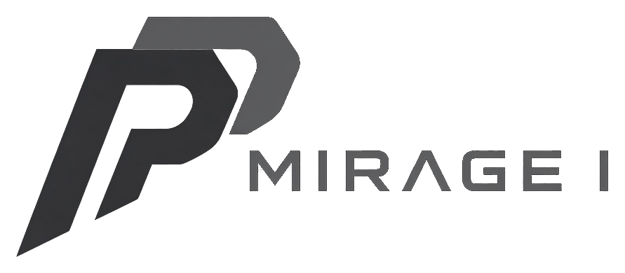

<p align="center">
  <picture>
    <source media="(prefers-color-scheme: dark)" srcset="docs/assets/phantom-mirage-logo.png">
    <source media="(prefers-color-scheme: light)" srcset="docs/assets/phantom-mirage-logo-light.png">
    
  </picture>
</p>

Phantom Mirage I (version: see AC_INIT in configure.ac, or run `phantom-mirage --version`)
Part of the Phantom deception product range.

Based on Honeyd, Copyright (c) 2002 - 2007 Niels Provos <provos@citi.umich.edu>
Distributed under the GNU General Public License, version 2 or later
(see LICENSE). See NOTICE for attribution and the rename map.
-------------------------------------------------------------------------

About Phantom Mirage:
-------------

Phantom Mirage is a small daemon that creates virtual hosts on a network.  The
hosts can be configured to run arbitrary services, and their TCP
personality can be adapted so that they appear to be running certain
versions of operating systems.  Phantom Mirage enables a single host to claim
multiple addresses - I have tested up to 65536 - on a LAN for network
simulation.

It is possible to ping the virtual machines, or to traceroute them.
Any type of service on the virtual machine can be simulated according
to a simple configuration file.  Instead of simulating a service, it
is also possible to proxy it to another machine.

Web console:
-------------

The Debian packages ship a web console (`phantom-mirage-console`, #118)
that shows sensor status, decoys, alerts and live activity. It listens
on **127.0.0.1:8443 only** over HTTPS with a self-signed certificate, and
an nftables table (`inet phantom_mirage`) drops the console port on every
interface except `lo` and drops SSH to the decoy addresses. The sensor
makes no outbound connections for it; alerts are shown in the console only.

`sudo phantom-mirage-setup` asks for the sensor name, admin user, port,
time source (local NTP or browser time, with drift warnings), time zone
and alert retention, then for the admin password at a hidden prompt (never
as an option). It prints the certificate's SHA-256 fingerprint: compare
it with what your browser shows on first visit.

To open it from your PC, tunnel the port over SSH:

```sh
ssh -L 8443:127.0.0.1:8443 user@sensor
```

and browse to <https://localhost:8443>. Other commands:

```sh
sudo phantom-mirage-setup --console              # (re)run only the console step
sudo phantom-mirage-setup --reconfigure-console  # change console settings
sudo phantom-mirage-setup --reset-admin          # new admin password (terminal only)
```

Upgrades (package or `install.sh`) keep the console config, admin
account, certificate and alerts; only `phantom-mirage-uninstall` removes
them (it asks first; `--yes` skips the question).

Installation:
-------------

Phantom Mirage depends on several libraries:

 - libevent  - event notification
 - libdnet   - packet creation
 - libpcap   - packet sniffing
 - libpcre   - perl regular expression library (optional; for subsystems)

Make sure that you have them installed.


On Debian or Ubuntu, `./install-from-source.sh` in the source checkout does
everything: it installs the packaging build dependencies with apt-get
(sudo when not root), builds the `phantom-mirage` and
`phantom-mirage-common` .debs from the checkout with
`dpkg-buildpackage -us -uc -b` and installs them with `apt-get`. That
gives the full packaged install: `phantom-mirage-setup`, the web console,
the systemd units and `/etc/phantom-mirage`. Nothing is enabled or started.

```sh
$ git clone https://github.com/danieldejager/phantom-mirage.git
$ cd phantom-mirage
$ ./install-from-source.sh                # asks before installing packages
$ ./install-from-source.sh --yes          # non-interactive
$ sudo phantom-mirage-setup               # then set it up; asks for the admin password at a hidden prompt
$ ./install-from-source.sh --help
```

The build runs in a temporary copy, so the checkout stays clean. The
.debs are left in `phantom-mirage-debs` next to the checkout (change it
with `--deb-dir DIR`). It is safe to run again and keeps existing console
and `/etc/phantom-mirage` config.

`--source-install` keeps the plain autogen, configure, make and make
install path instead (binaries and data only, no web console or
`phantom-mirage-setup`); `--prefix DIR` (default `/usr/local`) and
`--with-python` only apply there:

```sh
$ ./install-from-source.sh --source-install --prefix /opt/phantom-mirage
$ ./install-from-source.sh --source-install --with-python
```

To install dependencies in Ubuntu by hand:

```sh
$ sudo apt-get install build-essential autoconf automake libtool bison flex pkg-config libevent-dev libdumbnet-dev libpcap-dev libedit-dev zlib1g-dev libpcre3-dev
```

libpcre3-dev is optional and no longer exists on Ubuntu 26.04 or Debian
13; leave it out there (configure only supports PCRE 1, so the smtp and
proxy subsystems are not built without it).

To install dependencies in ArchLinux:

```sh
# First get these packages
$ pacman -S libdnet libpcap libevent pcre libedit bison flex libtool automake
```

Python is optional. The regression tests in regress/ need python3 and
python3-dpkt. Embedded Python 3 service scripts ("internal" services) need
./configure --with-python and python3-dev (see docs/python.md).

To build phantom-mirage, run the following commands:

```sh
$ ./autogen.sh
$ ./configure
$ make
$ sudo make install
```

Python support is off unless you pass --with-python. See docs/python.md.

If you get compilation warnings on Linux bitch to the people responsible
for the conditional header file idioticy.

Documentation:
--------------

You can find documentation as part of this release.  The manual
page can be accessed with the following commands:

```sh
$ man phantom-mirage
```

or in the source directory

```sh
$ nroff -mdoc phantom-mirage.8
```

More information can be found at http://www.honeyd.org/ and https://github.com/DataSoft/Honeyd

Running:
--------

Phantom Mirage requires root-privileges for execution.  Normally, you run it
with arguments similiar to the following:

```sh
$ sudo ./honeyd -d -f config.sample 10.0.0.0/8
```

It is strongly recommend that you run Phantom Mirage in a chroot environment
under a sandbox like systrace.  If possible, Phantom Mirage drops privileges
after creating its raw sockets.  This depends on your configuration
file.  You can force privileges to be dropped by setting Phantom Mirage's uid
and gid via the -u <uid> and -g <gid> flags.

Testing
-------

To empirically verify the quality of OS scan results, a bash script named
ostest is included. There are a few "gotcha"s with this, however. Normally,
phantom-mirage ignores packets coming from the same machine that it's running on
so as to avoid routing loops. (or so it claims, at least) So scanning
yourself doesn't work.

An ugly hack to make this work is to use a separate hardware ethernet
interface such as a cheap usb-ethernet adapter. You then have two eth adapters,
call them eth0 and eth1. Set up a route so that the IP address given to 
ostest is routing to eth0. You then set up phantom-mirage to listen on eth1. 

Phantom Mirage will see packets coming from eth0 and assume that it is a different
machine than ours, and not drop them.

License:
--------

This program is free software; you can redistribute it and/or modify
it under the terms of the GNU General Public License as published by
the Free Software Foundation; either version 2 of the License, or
(at your option) any later version.

This program is distributed in the hope that it will be useful,
but WITHOUT ANY WARRANTY; without even the implied warranty of
MERCHANTABILITY or FITNESS FOR A PARTICULAR PURPOSE.  See the
GNU General Public License for more details.

You should have received a copy of the GNU General Public License
along with this program; if not, write to the Free Software
Foundation, Inc., 59 Temple Place, Suite 330, Boston, MA  02111-1307  USA
This program is free software; you can redistribute it and/or modify
it under the terms of the GNU General Public License as published by
the Free Software Foundation; either version 2 of the License, or
(at your option) any later version.

This program is distributed in the hope that it will be useful,
but WITHOUT ANY WARRANTY; without even the implied warranty of
MERCHANTABILITY or FITNESS FOR A PARTICULAR PURPOSE.  See the
GNU General Public License for more details.

You should have received a copy of the GNU General Public License
along with this program; if not, write to the Free Software
Foundation, Inc., 59 Temple Place, Suite 330, Boston, MA  02111-1307  USA

Acknowledgments:
----------------

The following people have helped with suggestions, ideas or code:

  Dug Song <dugsong@monkey.org>
  Jamie Van Randwyk <jvanran@sandia.gov>
  Eric Thomas <edthoma@sandia.gov>
  Christopher Kolina
  Derek Cotton
  Yuqing Mai
  Lance Spitzner <lance@honeynet.org>
  Christian Kreibich <christian.kreibich@cl.cam.ac.uk>
  Bill Cheswick <ches@lumeta.com>
  Lauren Oudot <oudot@rstack.org>
  Jon Oberheide <jonojono@merit.edu>
  David Clark <david.clark@datasoft.com>
  Dan Petro <dan.petro@datasoft.com>
  David Scott <david.scott@datasoft.com>
  Addison Waldow <addison.waldow@datasoft.com>
  Rami Rashid <RamiRashid959@msn.com>
