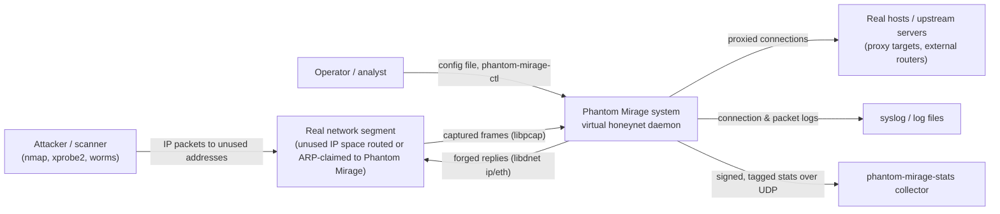
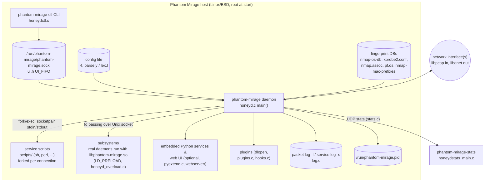

# 01 – System context and containers

Phantom Mirage is a single C daemon that pretends to be many hosts. It listens on a real network interface with libpcap, decides which *virtual host* (a "template") a packet is addressed to, and writes back forged replies with libdnet so that scanners see the operating system, open ports and network topology described in a configuration file. All code references are to `master` @ `a0f3d64`.

## System context (C4 level 1)

How traffic reaches Phantom Mirage is outside the code: either the router sends the unused address range to the Phantom Mirage box, a tool like `arpd` answers ARP for it, or Phantom Mirage itself answers ARP for templates that have an Ethernet address (`set <t> ethernet "<vendor>"`, `arp.c`).

## Containers (C4 level 2)

| Container | Source | Notes |
|---|---|---|
| `phantom-mirage` | honeyd.c and most other `.c` files (`honeyd_SOURCES` in Makefile.am) | Single-threaded libevent loop (`event_base_dispatch`, honeyd.c ~3990). |
| `phantom-mirage-ctl` | honeydctl.c | Connects to `UI_FIFO` (`/run/phantom-mirage/phantom-mirage.sock`, ui.h:54); commands are parsed by the same grammar as the config file (`ui` rule, parse.y:925), so templates can be changed live. |
| `phantom-mirage-stats` | honeydstats_main.c, honeydstats.c, analyze.c, filter.c, keycount.c | Separate process that aggregates stats reports sent by `stats.c` (enabled with phantom-mirage's stats options). |
| `phantom-mirage-sniff` | hsniff.c | Stand-alone sniffer tool; not part of the honeypot path. |
| Fingerprint DBs | nmap-os-db, xprobe2.conf, nmap.assoc, pf.os, nmap-mac-prefixes | Loaded at startup in `main()`; paths overridable with `-p`, `-x`, `-a`, `-0`, `-m`. |
| Scripts | scripts/ | Emulated services; get connection details in `PHANTOM_MIRAGE_*` env vars (command.c:226–259). |
| Subsystems | subsystems/ (smtp, proxy), honeyd_overload.c | Real programs whose socket calls are intercepted by `libphantom-mirage.so`. |
