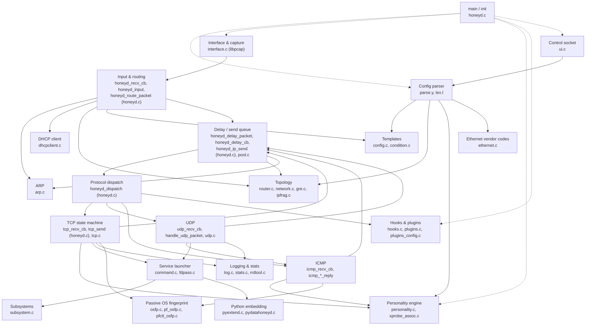

# 02 – Components

The daemon is one binary but cleanly splits into modules by source file. The diagram shows the main call directions at runtime (startup-only calls are dashed).

## Module notes

- **Interface & capture (interface.c)** – `interface_initialize()` stores the receive callback; `interface_init()` (interface.c:310) opens each `-i` device with libpcap, compiles a BPF filter that covers configured addresses (`if_filter`), and registers the pcap fd with libevent. Each frame goes to `honeyd_recv_cb()` (honeyd.c:3373).
- **Input & routing (honeyd.c)** – `honeyd_input()` (honeyd.c:3258) either looks up the template directly (`template_find_best`, config.c:254) or, if `route` statements exist (`router_used`), walks the virtual topology in `honeyd_route_packet()` (honeyd.c:3109).
- **Delay queue** – every packet, inbound or outbound, goes through `honeyd_delay_packet()` (honeyd.c:899). With zero delay it is processed immediately; otherwise a libevent timer fires `honeyd_delay_cb()`. This is how link latency is simulated. Outbound packets go out via libdnet `ip_send`, Ethernet (`honeyd_send_ethernet`, with ARP resolution), or GRE (`gre_encapsulate`).
- **Protocol handlers** – TCP has a small state machine per `struct tcp_con`; UDP keeps short-lived `struct udp_con` state; ICMP is stateless. Unknown protocols are only logged (`honeyd_dispatch`, honeyd.c:3036).
- **Personality engine (personality.c, ~2.8k lines)** – parses the nmap second-generation DB (`personality_parse`, personality.c:2349) and Xprobe2 DB, then shapes outgoing packets (IP ID, TTL, DF, window, TCP options, ISN) via `ip_personality()` and `tcp_personality()`.
- **Service launcher (command.c)** – `generic_connect()` (honeyd.c:1416) chooses by `enum status`: fork a script (`cmd_fork`, command.c:374), proxy to a real host (`proxy_connect`), hand the connection to a subsystem (`cmd_subsystem_schedule_connect`), or call Python (`cmd_python`).
- **Subsystems (subsystem.c + honeyd_overload.c)** – long-running real programs started with `libhoneyd.so` preloaded; their `socket/bind/listen/connect` calls are turned into `struct subsystem_command` messages and Honeyd passes them file descriptors (fdpass.c).
- **Hooks/plugins** – `hooks_dispatch()` (hooks.c:207) lets dlopen'd plugins see incoming/outgoing packets; `option` statements in config feed plugins_config.c.
- **UI** – `ui_init()` (ui.c:351) listens on `/var/run/honeyd.sock`; each line is fed to the yacc parser, so the live control language equals the config language.
- **Logging/stats** – `honeyd_log_probe()` / `honeyd_log_flownew()` etc. (log.c); stats.c sends aggregated records to honeydstats; rrdtool.c optionally pipes to rrdtool.
