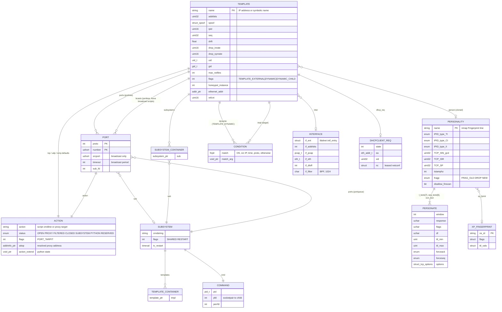
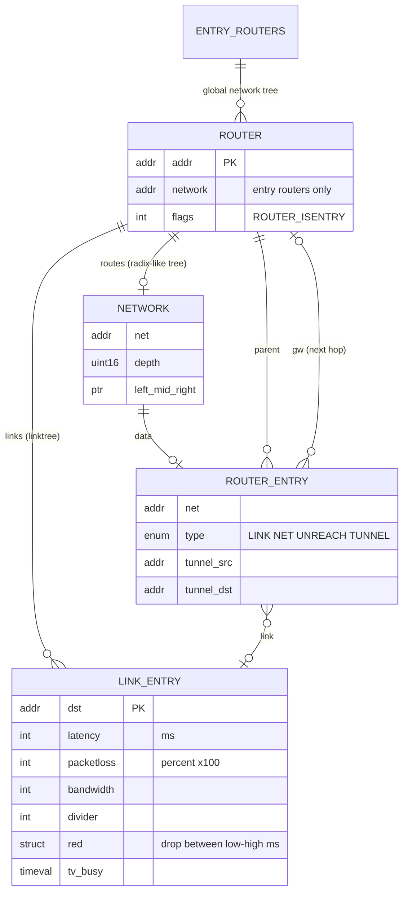
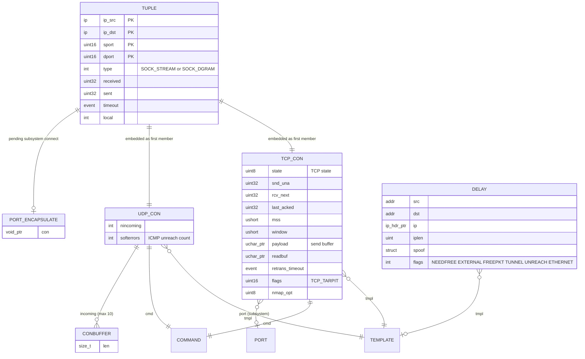

# 03 – Data model (in-memory)

Phantom Mirage has no database. All state lives in C structs held in BSD `tree.h` splay trees (`SPLAY_HEAD`) and `queue.h` lists (`TAILQ_HEAD`) from `compat/sys/tree.h`. The diagrams below use Mermaid ER notation; "PK" marks the field used as the splay-tree key.

## Configuration entities

Key points:
- **Templates are the virtual hosts.** `create foo` makes a named profile; `bind 10.0.0.5 foo` calls `template_clone()` (config.c:731) to make a new template *named by the IP address*. Lookup by destination IP is therefore a string lookup in the `templtree` (`template_find`, then fallback `"default"`, then dynamic resolution – config.c:254).
- Templates are reference counted (`template_ref` / `template_free` macros in template.h) because connections hold pointers to them.
- `personality_clone()` copies the parsed fingerprint into the template so per-host counters (ISN, IP ID) are independent.

## Routing topology

`entry_routers` and `reverse` (globals in router.c) are `struct network` trees used by `honeyd_input()` to choose the router where a packet enters the virtual topology.

## Connection state

TCP and UDP connections live in two splay trees (`tcpcons`, `udpcons`) keyed on the 4-tuple (`conhdr_compare`, util.c:363; trees declared honeyd.c:124–126) plus LRU lists (`struct conlru`) used to evict old state (limit `PHANTOM_MIRAGE_MAX_CONNECTS` = 32000, honeyd.h). Timeouts: SYN/close-wait 60 s, idle 300 s, UDP 60 s (honeyd.h).
