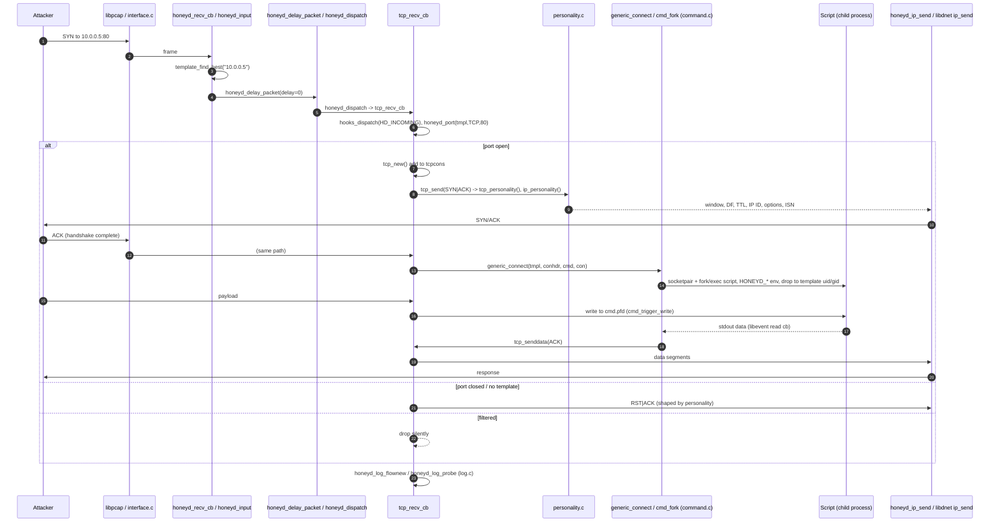
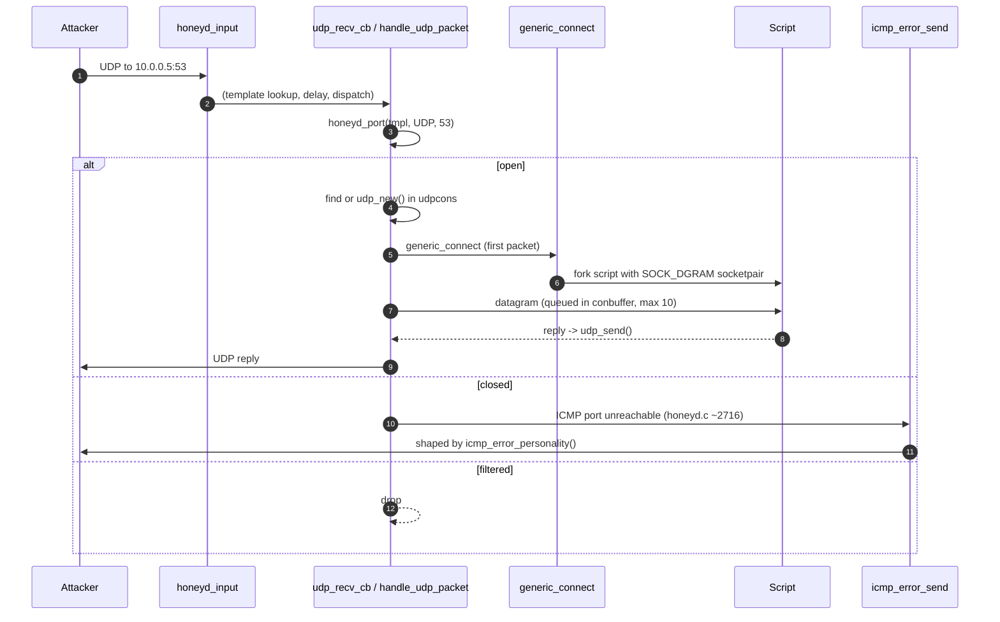
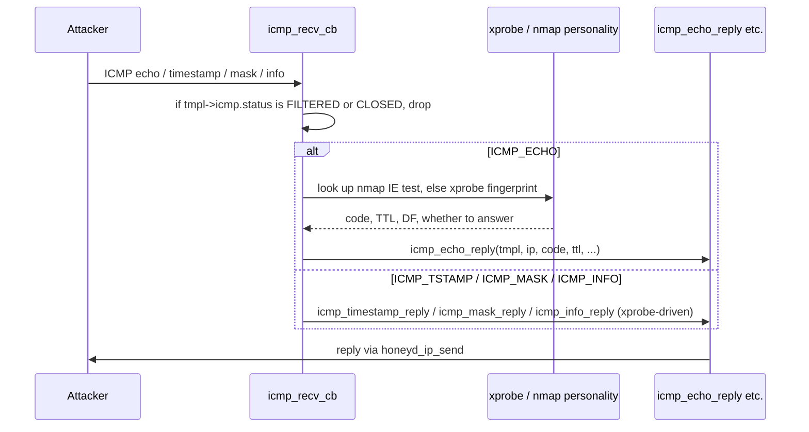
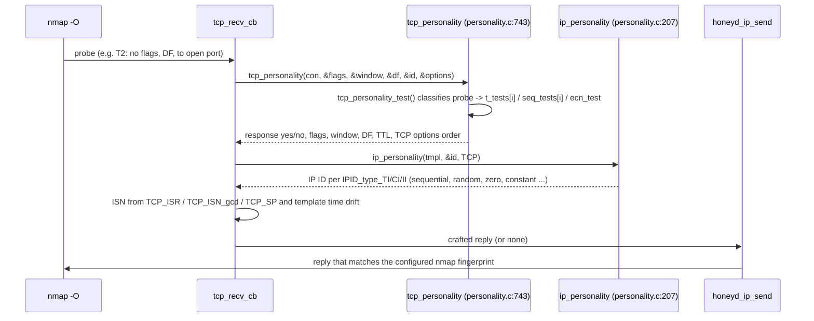
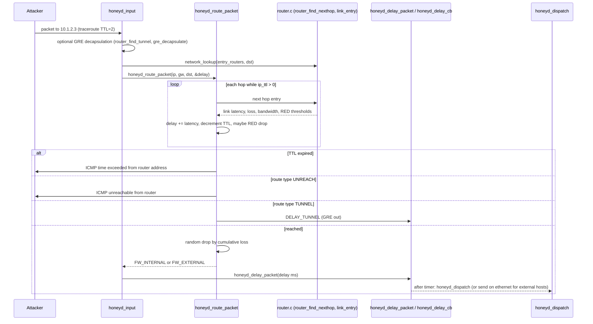

# 04 – Packet flows

All flows start in libevent: the pcap fd becomes readable, `interface_recv` (interface.c) calls `pcap_dispatch`, which calls `honeyd_recv_cb()` (honeyd.c:3373). Everything is single-threaded; "async" below means a libevent callback later in the same loop.

## 4.1 TCP SYN to a scripted service

Notes: `generic_connect()` (honeyd.c:1416) is also where `proxy` (`proxy_connect`), `subsystem` (`cmd_subsystem_schedule_connect`) and `PORT_PYTHON` (`cmd_python`) are chosen. The tarpit flag (`PORT_TARPIT`) sets `TCP_TARPIT` on the connection (honeyd.c:2219), which advertises a window of 5 bytes and sends at most 1 byte per segment (honeyd.c:1567, 1670).

## 4.2 UDP

## 4.3 ICMP

## 4.4 OS fingerprint spoofing (nmap probes)

Inbound packets are also matched against the passive PF fingerprints (`honeyd_osfp_init`, osfp.c / pf_osfp.c) so the *attacker's* OS is known; this feeds `HONEYD_REMOTE_OS` (command.c:236) and `source os =` conditions for dynamic templates (condition.c).

## 4.5 Routing topology simulation

Replies traverse the topology in reverse inside `honeyd_ip_send()` (honeyd.c:961), which uses the `reverse` network tree to find the source router, so latency is applied in both directions.
