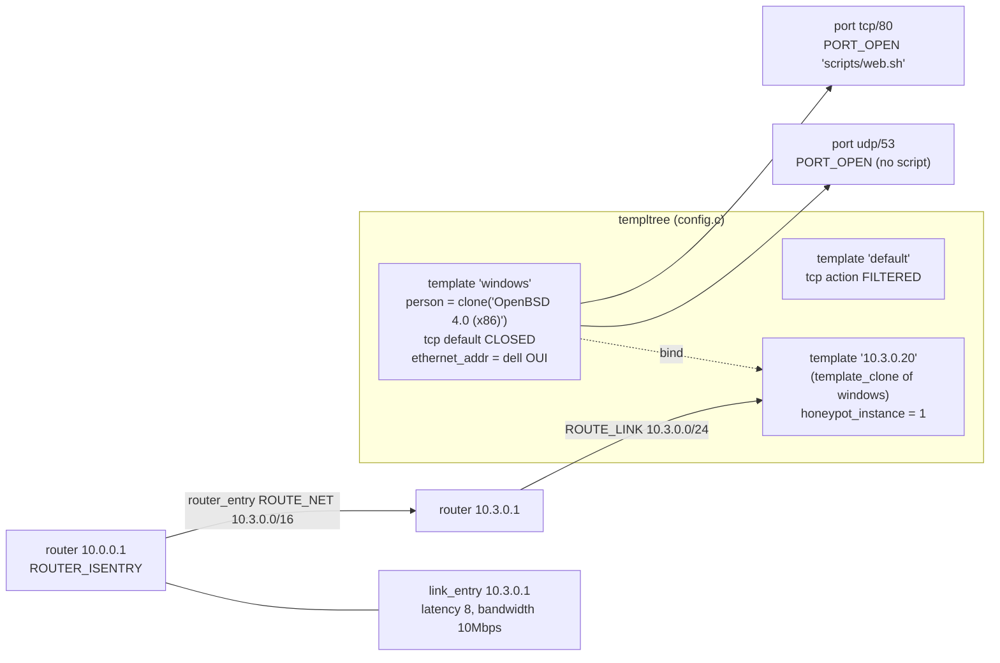

# 05 – Configuration language

The config file (`-f`) and live `phantom-mirage-ctl` commands share one grammar: `parse.y` (yacc) with tokens from `lex.l` (flex). `config_read()` (config.c:127) feeds the file to `yyparse()`; each grammar action calls straight into config.c / router.c / personality.c to build the structs in [03-data-model.md](03-data-model.md). There is no intermediate AST: parsing *is* construction.

## Statement → code → struct

| Statement (parse.y rule) | Calls | Builds / changes |
|---|---|---|
| `create <name>` / `create default` (creation, :170) | `template_create()` config.c:269 | new `struct template` in `templtree` |
| `dynamic <name>` (:186) | `template_create()` + `TEMPLATE_DYNAMIC` flag | dynamic template (chooses a child per packet) |
| `add <t> use <t2> if <condition>` / `otherwise use` (:241, :249) | `template_insert_dynamic()` config.c:996 | `struct condition` on `tmpl->dynamic` (conditions: `source os =`, `source ip =`, `time between`, proto – parse.y:1005) |
| `add <t> tcp\|udp port <n> <action>` (addition, :223) | `template_add()` config.c:650 | `struct port` + `struct action` in `tmpl->ports` |
| `add <t> subsystem "<cmd>" [shared] [restart]` (:258) | `template_subsystem()` | `struct subsystem`, `subsystem_container` |
| `broadcast <t> srcport N dstport N time N <action>` (newbcast, :212) – *DataSoft/Nova addition* | `bcast_insert()` config.c:585; timer `bcast_trigger()` :539 | `struct port` in `tmpl->bcasts`, periodic script that emits broadcast UDP |
| `set <t> default tcp\|udp\|icmp action <action>` (set, :402) | `honeyd_protocol()` | `tmpl->tcp/udp/icmp` |
| `set <t> personality "<nmap name>"` / `random` (:420) | `personality_find()` personality.c:197, `personality_clone()` | `tmpl->person` |
| `set <t> ethernet "<vendor or MAC>"` (:426) | `ethernetcode_make_address()` ethernet.c:294, `template_post_arp()` | `tmpl->ethernet_addr`, ARP entry; Phantom Mirage now answers ARP for this host |
| `set <t> uptime N`, `droprate in/syn R`, `maxfds N`, `uid N [gid N]` (:450–499) | direct assignment | `tmpl->tv`, `drop_inrate`, `drop_synrate`, `max_nofiles`, `uid/gid` |
| `set <t> spoof from <ip> [to <ip>]` (:376–392) | direct assignment | `tmpl->spoof` |
| `bind <ip> <t>` (binding, :275) | `template_clone()` config.c:731 | new template named by IP, `honeypot_instance` set |
| `bind <condition> <ip> <t>` (:303) | clone + dynamic | |
| `bind <ip> to <interface>` (:327) | | `TEMPLATE_EXTERNAL` – a real host integrated into the topology |
| `dhcp <t> on <iface> [ethernet "<mac>"]` (:355) | dhcpclient.c | template clone whose IP is leased via DHCP (`dhcp_req`) |
| `clone <name> <t>` (:369) | `template_clone()` | |
| `delete <t> [proto port N]` (:196) | `template_remove()` | |
| `annotate "<pers>" [no] finscan` / `fragment drop\|old\|new` (:513) | | `personality.disallow_finscan`, `fragp` |
| `route entry <ip> [network <net>]` (:526) | `router_start()` router.c:410 | entry `struct router`, `entry_routers` |
| `route <ip> add net <net> <gw> [latency Nms] [loss R] [bandwidth N] [drop between a ms - b ms]` (:538) | `router_add_net()` router.c:517 | `router_entry` + `link_entry` (both directions) |
| `route <ip> add net <net> tunnel <src> <dst>` (:569) | `router_add_tunnel()` | `ROUTE_TUNNEL` (GRE) |
| `route <ip> link <net>` / `unreach <net>` (:582, :595) | `router_add_link()` / `router_add_unreach()` | `ROUTE_LINK` / `ROUTE_UNREACH` |
| `option <plugin> <key> <value>` (:875) | plugins_config.c | plugin settings |
| `list template [glob]`, `list subsystem`, `debug …` (ui, :925) | `template_list_glob()` etc. | read-only (meant for phantom-mirage-ctl) |

### Actions (`action` rule, parse.y:676)

| Syntax | `enum status` | Effect |
|---|---|---|
| `"scripts/web.sh"` | `PORT_OPEN` + action string | fork script per connection (`cmd_fork`) |
| `open` | `PORT_OPEN`, no string | handshake, accept data, no service |
| `closed` / `reset` | `PORT_CLOSED` | RST / ICMP unreachable |
| `filtered` / `block` | `PORT_FILTERED` | silent drop |
| `proxy <ip>:<port>` (also `$ipsrc:port` forms) | `PORT_PROXY` | connect to real host and relay |
| `internal "<python module>"` | `PORT_PYTHON` | `pyextend_load_module()` (parse.y:693–705); error if built without Python |
| `tarpit <action>` | adds `PORT_TARPIT` flag | slow the connection |

## Worked example (from config.sample)

```
route entry 10.0.0.1
route 10.0.0.1 add net 10.3.0.0/16 10.3.0.1 latency 8ms bandwidth 10Mbps
route 10.3.0.1 link 10.3.0.0/24

create default
set default default tcp action filtered

create windows
set windows personality "OpenBSD 4.0 (x86)"
set windows uptime 1728650
add windows tcp port 80 "scripts/web.sh"
add windows udp port 53 open
set windows ethernet "dell"
set windows default tcp action closed

bind 10.3.0.20 windows
```



A packet to 10.3.0.20 enters at router 10.0.0.1, accrues 8 ms delay, reaches the `10.3.0.20` template, port 80 runs `scripts/web.sh`, all other TCP ports reset, and replies look like OpenBSD 4.0 with a Dell MAC.
