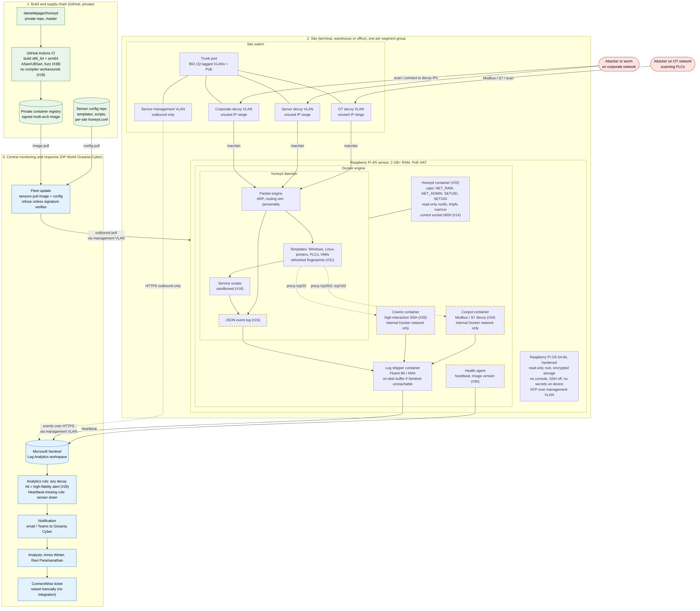
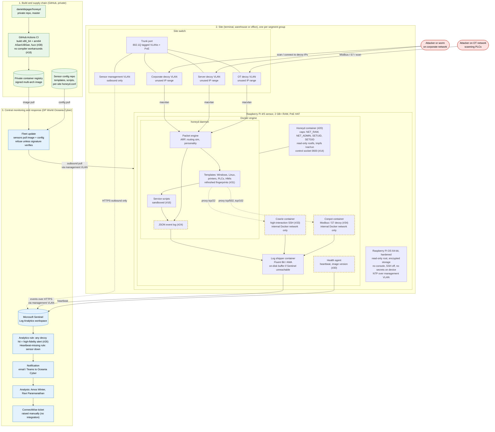

# 10 – Target deployment architecture (proposal)

This is the proposed way to deploy Honeyd at DP World Oceania, as discussed on 19 Oct 2026. It's a **recommendation, not the current state**. Dashed boxes are planned features that depend on open issues. Issue numbers are shown in brackets.

## The design in short

1. **Hardware sensor.** Each site gets a Raspberry Pi 4 or 5 (2 GB+ RAM, PoE HAT) on a switch trunk port. One Pi can sit on several decoy VLANs at once using 802.1Q tags.
2. **Container on the Pi.** Honeyd runs in one Docker container (#20), attached to each decoy VLAN through macvlan so it sees raw traffic and answers ARP. The container gets only the network capabilities it needs, a read-only filesystem and a locked control socket (#14).
3. **One container per Honeyd, not per fake host.** A single Honeyd process simulates every decoy on every attached VLAN.
4. **High-interaction decoys as sidecars.** Honeyd proxies selected ports to purpose-built containers: Cowrie for SSH (#33) and Conpot for Modbus and S7 (#34). Honeyd fakes everything else.
5. **Visibility.** Honeyd writes JSON events (#24). A log shipper sends them, together with a heartbeat (#30), to Microsoft Sentinel over an outbound-only management VLAN.
6. **Response.** Any decoy hit is a high-fidelity alert (#26), and a missing heartbeat means a sensor is down. Alerts go to Oceania Cyber. ConnectWise tickets are raised manually because there's no integration.
7. **Supply chain.** CI builds a signed multi-arch image (x86_64 + arm64) from `master` with sanitizers (#18, #38). Sensors pull the image and their site config, so updating the fleet doesn't need reflashing.

## Constraints and assumptions

- Nothing has been built on ARM yet; that's untested.
- A Pi on an OT network needs DP World change control and sign-off from the OT owner first.
- Decoy VLANs must use IP ranges that are genuinely unused.
- The Pi's management interface reaches only Sentinel, the registry and the config repo, and never accepts inbound connections.
- No secrets are stored on the device, because a Pi in a comms room can be stolen or opened.
- Sensors refuse to run any image whose signature doesn't verify.
- Cowrie and Conpot sit on an internal Docker network that only Honeyd can reach, and have no direct presence on the decoy VLANs.
- The log shipper buffers events on disk while Sentinel is unreachable, and the Pi keeps time with NTP over the management VLAN so alert timestamps line up.

## Diagram source

