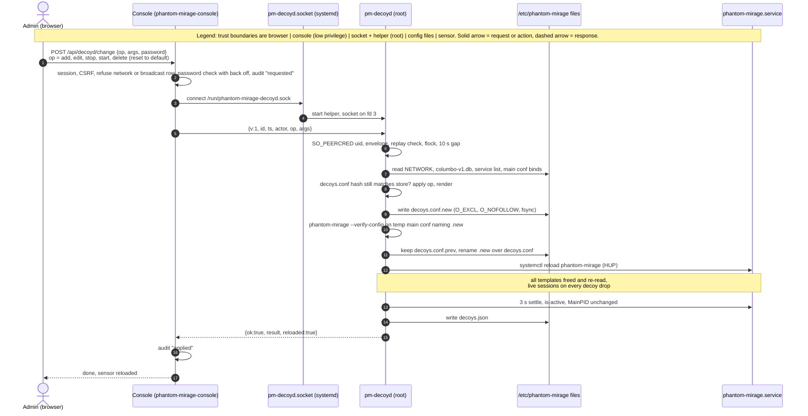
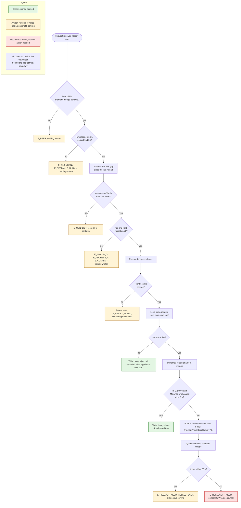
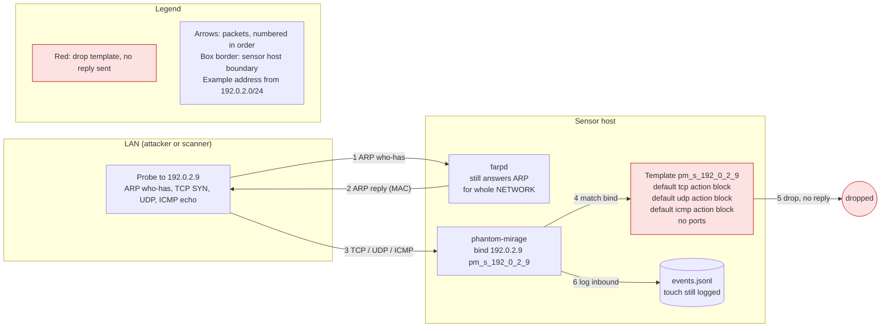
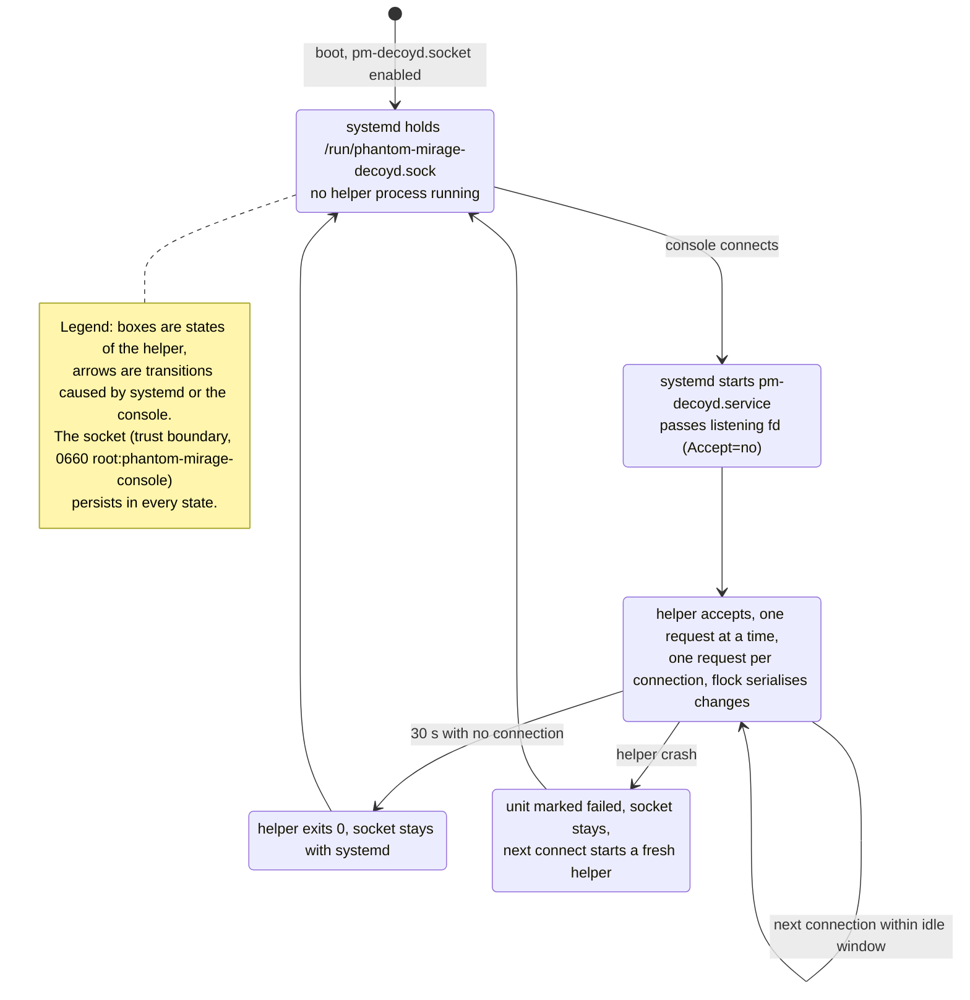
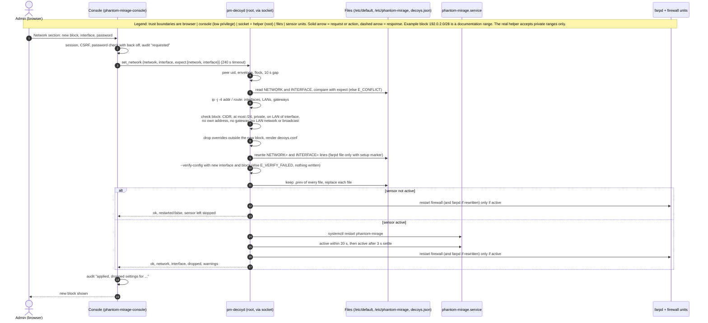
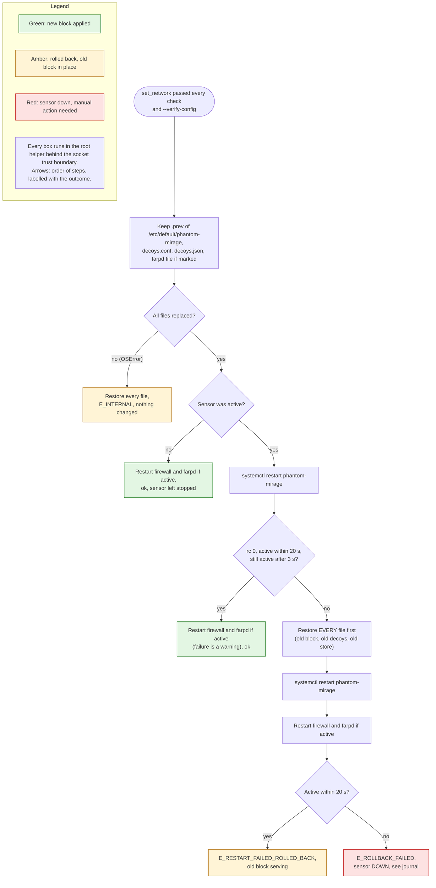

# Decoy management from the console: design

**Status.** Design document, updated to match the code on branch feat/decoy-settings (draft PR 256, head 8a4cbe6, not merged). Where this document says "implemented", it means implemented on that branch only. Nothing here is on master. Each section says what is built, what is tested offline, and what has not been tried on a real systemd host.

Labels used below:

- **Implemented (PR 256)**: the code exists on feat/decoy-settings, draft PR 256, not merged.
- **Tested offline**: covered by unit or shell tests that run without systemd, using a fake `systemctl`, a fake daemon and temp directories. I ran these tests on PR 256 head 8a4cbe6: decoyd/tests 56 tests pass (3 skipped), console/tests 137 tests pass, ci/test_decoys_include.sh and ci/test_decoyd_socket.sh pass.
- **Untested on a real host**: nothing in PR 256 has been seen working under real systemd, with a real socket, real reload or restart, or on a real LAN.
- **Not started**: no code yet.

## In short

- From the console you can now (on PR 256, not merged) give one decoy its own operating system look and its own services, stop it, start it again, or put it back on the shared default.
- You can also change the address block and the network interface the sensor uses, from a new Network section. This is a decision, not a proposal.
- The first and last address of the block (network and broadcast) show no Stop or Start button and no settings gear. They are marked reserved.
- The console stays a low privilege program. A small separate helper, `pm-decoyd`, started only when needed, makes the change after checking every value against fixed lists. You must type your password for every change.
- If a change would break the sensor, the helper refuses it, or puts the old files back and restarts the sensor.
- A decoy change reloads all decoys, so anyone connected to any decoy at that moment is cut off. An address block change restarts the whole sensor.
- Deleting a decoy is not started. It is a later slice.
- All of this passes its offline tests. None of it has been tried on a real sensor host yet.

## 1. Overview (plain words)

**What it is.** Phantom Mirage pretends to be several computers on your network. These pretend computers are called decoys. Before this work all decoys shared one setup, and changing anything meant editing a configuration file by hand on the sensor.

**What you can do on PR 256 (not merged).** From the web console you can:

- see each decoy's settings in detail;
- give a decoy its own personality, chosen from the profiles in the sensor's pinned personality file;
- choose which services a decoy appears to offer, picked from a fixed list of 25 (for example "SSH" on tcp 22);
- set what the decoy does with any other port (open, closed, reset, block, filtered);
- stop a decoy so it no longer answers, and start it again;
- put a decoy back on the shared default ("Use default template");
- change the address block and interface in the Network section.

**What changes for you.**

- You no longer need to edit files on the sensor for these tasks.
- Every change asks for your password again.
- A decoy change takes a few seconds and reloads every decoy, cutting any connection open to any decoy at that moment.
- An address block change restarts the sensor, and restarts farpd and the firewall if they are running. Settings for decoys that fall outside the new block are dropped, and the console tells you which.
- A stopped decoy goes quiet, but other machines can still see that something owns the address.

**What does not change.**

- You cannot type commands or file names anywhere. Only choices from fixed lists are accepted.
- The console keeps the same login, the same address (only on the sensor itself) and the same low privileges.
- The hand edited main config still works. Addresses bound there are shown as "main config" and cannot be changed from the console.

## 2. Goals and non goals

Goals

- Per decoy personality, default actions and port list from the console. Implemented (PR 256).
- Stop and start a single decoy. Implemented (PR 256).
- Change the address block and interface from the console. Implemented (PR 256).
- No free text from the browser ever reaches the sensor config.
- Every change checked by the sensor's own `--verify-config` before it goes live, with automatic rollback.

Non goals

- Deleting a decoy (taking an address out of service). Not started, later slice. See section 10.
- Service scripts, proxies, tarpits or backdoor emulations. The service list maps each service to a plain port action only.
- More than one address block, blocks wider than /24, or public ranges from the console.
- Per address ARP control. farpd still answers for the whole block.

## 3. Architecture and trust boundaries

Source: [img/src/01-architecture.mmd](img/src/01-architecture.mmd)

### Components

| Component | What it is | Status |
|---|---|---|
| `pm-console.py` + `decoyclient.py` | Console web server (user phantom-mirage-console). Routes `GET /api/decoyd/list`, `/api/decoyd/options`, `/api/decoyd/netinfo` and `POST /api/decoyd/change`. Client sends one JSON line per connection, timeout 90 s, 240 s for set_network. | Implemented (PR 256), tested offline |
| `pm-decoyd.socket` | `ListenStream=/run/phantom-mirage-decoyd.sock`, `SocketUser=root`, `SocketGroup=phantom-mirage-console`, `SocketMode=0660`, `Accept=no` | Implemented (PR 256), untested on a real host |
| `pm-decoyd.service` | Runs `/usr/bin/python3 -I /usr/lib/phantom-mirage/pm-decoyd` as root. Refuses to start unless systemd passed exactly one socket (fd 3). Exits after 30 s with no connection. | Implemented (PR 256), untested on a real host |
| `/usr/lib/phantom-mirage/pm-decoys-include` | Postinst script: creates `/etc/phantom-mirage/decoys.conf` with a header if missing, appends `include /etc/phantom-mirage/decoys.conf` to phantom-mirage.conf once, after a backup to `phantom-mirage.conf.pre-decoys.bak`. Refuses symlinked config. | Implemented (PR 256), tested offline (ci/test_decoys_include.sh) |
| `/usr/lib/phantom-mirage/pm-decoyd-socket` | Postinst script: when the console is enabled (or the socket already is), enables and restarts the socket and stops an old helper. A failing systemctl does not fail the install. | Implemented (PR 256), tested offline with a fake systemctl (ci/test_decoyd_socket.sh) |
| `/usr/share/phantom-mirage/decoy-services.json` | 25 services, each an id, label, proto, port and a plain action `open`. No scripts. | Implemented (PR 256) |
| `/var/lib/phantom-mirage/decoys.json` | Helper store: `{v:1, overrides:{ip:{rev, state, decoy}}, conf_sha256}`, root 0600 | Implemented (PR 256) |
| `/etc/phantom-mirage/decoys.conf` | Generated from the store, root 0644, with `decoys.conf.prev` kept | Implemented (PR 256) |

### Trust boundaries

1. **Browser to console.** Existing login, session cookie and `X-CSRF-Token`. New: password re-entry on every change, with back off after wrong passwords. The console also refuses network and broadcast addresses before calling the helper.
2. **Console to helper.** The socket is root:phantom-mirage-console 0660, and the helper checks `SO_PEERCRED` and refuses any uid other than the console user (`E_PEER`). Everything the console sends is checked again by the helper. The helper never trusts the console's checks.
3. **Helper to sensor.** The helper writes only fixed paths, verifies with the real daemon, and talks to systemd with `systemctl`.

### Helper unit hardening (as written in PR 256)

`NoNewPrivileges`, `ProtectSystem=strict` with `ReadWritePaths=/etc/phantom-mirage /var/lib/phantom-mirage /etc/default`, `ProtectHome`, `PrivateTmp`, kernel and control group protections, `IPAddressDeny=any`, `RestrictAddressFamilies=AF_UNIX AF_INET AF_INET6 AF_PACKET AF_NETLINK`, `MemoryDenyWriteExecute`, `SystemCallFilter=@system-service`, `UMask=0077`, `CapabilityBoundingSet=CAP_NET_RAW`.

Two things differ from the first draft of this design:

- There is **no** `PrivateNetwork`, and `CAP_NET_RAW` is kept, because `--verify-config` opens the interface. Network access is limited by `IPAddressDeny=any` instead.
- `/etc/default` is writable as a whole directory, because set_network rewrites `/etc/default/phantom-mirage` and maybe `/etc/default/farpd`.

Whether this unit can really run `systemctl reload` and `restart`, and open the interface for verify, under these settings has **not** been checked on a real host.

### Generated config model

The main config keeps its hand written templates and binds and gains one line, `include /etc/phantom-mirage/decoys.conf`. The helper writes decoys.conf from the store only. For each override, in address order:

- **Running:** template `pm_d_<ip with underscores>`, for example `pm_d_192_0_2_9`. `set ... personality "<name>"` if one is chosen, `set ... default tcp|udp|icmp action <state>`, then one `add ... <tcp|udp> port <N> <action>` per port. A service entry is written as its fixed action from the service list, never as a command.
- **Stopped:** template `pm_s_<ip>` with `default tcp`, `udp` and `icmp action block` and no personality and no ports.
- Then `bind <ip> <template>`.

The helper keeps the sha256 of the text it last wrote. If decoys.conf on disk no longer matches, every change except reset_all is refused with `E_CONFLICT` until you reset all overrides.

## 4. Data flow diagrams

### 4.1 Decoy change (add, edit, stop, start, reset to default)

Implemented (PR 256), tested offline with a fake systemctl and fake daemon. Untested on a real host.

Source: [img/src/02-change-flow.mmd](img/src/02-change-flow.mmd)

### 4.2 Decoy change failure and rollback

Implemented (PR 256). Rollback paths tested offline (daemon died, new MainPID, reload rc, rollback failed, no previous file). Untested on a real host.

Source: [img/src/03-rollback.mmd](img/src/03-rollback.mmd)

### 4.3 Stop by drop template

Rendering implemented (PR 256) and checked by golden output tests. The packet behaviour shown here (no reply while ARP is still answered) has **not** been tested on a real LAN.

Source: [img/src/04-stop-drop.mmd](img/src/04-stop-drop.mmd)

### 4.4 Socket activation lifecycle

Implemented (PR 256): the helper exits after 30 s idle and refuses to start without `LISTEN_FDS=1`. Offline tests use a socket pair. Real socket activation is untested.

Source: [img/src/05-socket-lifecycle.mmd](img/src/05-socket-lifecycle.mmd)

### 4.5 Address block change (set_network)

Implemented (PR 256), tested offline with a fake systemctl, fake `ip` output and a fake daemon. Untested on a real host.

Source: [img/src/06-set-network.mmd](img/src/06-set-network.mmd)

### 4.6 Address block change rollback

Implemented (PR 256). Offline tests check that a failed restart puts every file back and that the old `/etc/default/phantom-mirage` is in place before the second restart; that a failed rollback gives `E_ROLLBACK_FAILED` with the files restored; and that a failed verify writes nothing and restarts nothing. Untested on a real host.

Source: [img/src/07-set-network-rollback.mmd](img/src/07-set-network-rollback.mmd)

## 5. Message format (typed JSON over the unix socket)

### 5.1 Framing

One request per connection: one JSON line in, one JSON line out. Requests over 16384 bytes, or not finished within 5 s, get `E_BAD_JSON`. Replies are capped at 1 MiB by the client.

### 5.2 Envelope

Request: `{"v":1, "id":"<1 to 64 of A-Z a-z 0-9 ->", "ts":<unix seconds>, "actor":"<1 to 64 of A-Z a-z 0-9 . _ ->", "op":"<op>", "args":{...}}`

- `v` must be 1 (`E_VERSION`). Unknown fields give `E_UNKNOWN_FIELD`; duplicate keys give `E_BAD_JSON`.
- `ts` must be within 60 s of the helper's clock, and an `id` may not be reused within 600 s (`E_REPLAY`). Seen ids are kept in `/run/phantom-mirage-decoyd/seen.json` so they survive a helper restart.

Reply: `{"v":1, "id", "ok":true|false, "reloaded":bool, "rolled_back":bool, "result":{...}}` or, on failure, `"error":{"code", "field", "message"}`. Tracebacks are never sent.

### 5.3 Operations

| Op | Args | Result | Status |
|---|---|---|---|
| `list` | none | `network`, and one entry per address with `source` override, default or main_conf | Implemented |
| `options` | none | personalities, states, services (id, label, proto, port), `max_ports` 64 | Implemented |
| `netinfo` | none | current network and interface, interfaces with addresses, gateways, `min_prefix` 24 | Implemented |
| `add` | `decoy` | `ip`, `state` running, `rev` 1 | Implemented |
| `edit` | `decoy`, `expect_rev` (required) | new `rev` | Implemented |
| `stop` | `ip`, `expect_rev` if an override exists | `state` stopped, `arp` "still_answered" | Implemented |
| `start` | `ip`, `expect_rev` | running; a stop on a default decoy is simply removed | Implemented |
| `delete` | `ip`, `expect_rev` | removes the override so the address is back on the default template | Implemented as "reset to default" only, see note |
| `reset_all` | `confirm` = "reset-all" | `overrides` 0 | Implemented in the helper; not exposed in the console UI as far as I could see |
| `set_network` | `network`, `interface`, `expect:{network, interface}` | `network`, `interface`, `dropped`, `farpd`, `restarted`, maybe `warnings` | Implemented |

**Note on `delete`.** The helper op called `delete` removes a decoy's own settings. The console uses it for the "Use default template" button. It does **not** take an address out of service. Deleting a decoy in that sense is not started (section 10). The op name is confusing and is listed as an open question.

A `decoy` object has exactly `ip`, `personality` (a name or null), `defaults` `{tcp, udp, icmp}` and `ports`, a list of `{proto, port, state}` or `{proto, port, service}`.

### 5.4 Error codes

| Group | Codes | Console HTTP status |
|---|---|---|
| Transport (client side) | `E_UNAVAILABLE`, `E_TIMEOUT`, `E_BAD_REPLY` | 503 |
| Envelope | `E_PEER` (500), `E_BAD_JSON`, `E_VERSION`, `E_UNKNOWN_FIELD`, `E_MISSING_FIELD`, `E_TYPE`, `E_REPLAY`, `E_UNKNOWN_OP` | 400 unless shown |
| Queue | `E_BUSY` (lock not free within 25 s), `E_RATE_LIMIT` | 429 |
| Decoy validation | `E_INVALID_ADDRESS`, `E_ADDRESS_OUTSIDE_NETWORK`, `E_ADDRESS_RESERVED`, `E_ADDRESS_IN_MAIN_CONF`, `E_INVALID_PERSONALITY`, `E_INVALID_STATE`, `E_INVALID_PORT`, `E_INVALID_SERVICE`, `E_TOO_MANY_PORTS` | 400 |
| State | `E_CONFLICT`, `E_EXISTS`, `E_NOT_FOUND`, `E_NOT_RUNNING`, `E_NOT_STOPPED`, `E_UNCHANGED` | 409 |
| Network validation | `E_INVALID_NETWORK`, `E_NETWORK_TOO_WIDE`, `E_NOT_PRIVATE`, `E_INVALID_INTERFACE`, `E_NOT_ON_LAN`, `E_HOST_ADDRESS`, `E_GATEWAY`, `E_LAN_EDGE` | 400 |
| Apply | `E_VERIFY_FAILED` (400), `E_RELOAD_FAILED_ROLLED_BACK`, `E_RESTART_FAILED_ROLLED_BACK`, `E_ROLLBACK_FAILED`, `E_INTERNAL` | 500 unless shown |

The console itself answers 403 for a wrong password, 423 while backing off after wrong passwords, and 400 `E_ADDRESS_RESERVED` for a network or broadcast address.

`E_RATE_LIMIT` is only raised if the wait would exceed 25 s. With a 10 s gap the helper normally just waits, so in practice it should not appear.

## 6. Validation rules (as coded)

Decoy fields

- `ip`: canonical dotted IPv4, inside NETWORK, not bound in the main config, and not the network or broadcast address of its block when the block is /30 or wider. /31 and /32 have no reserved address.
- `personality`: matches `[A-Za-z0-9._+-]{1,64}` and is a `Fingerprint` name in `/etc/phantom-mirage/columbo-v1.db`. The file's sha256 must match `columbo-v1.db.sha256` or every change fails.
- `defaults` and port `state`: one of open, closed, reset, block, filtered.
- `ports`: at most 64, proto tcp or udp, port 1 to 65535 as an integer, no duplicate proto and port, exactly one of `state` or `service`. A service must exist in the list and use the same proto.
- Strings from root owned lists are checked against control characters, quotes, `#` and backslash.

Address block (set_network)

- `expect` must equal the current NETWORK and INTERFACE, else `E_CONFLICT`.
- `network` written as `a.b.c.d/n`, the exact start of a block (host bits give a hint with the right start), at most /24 (no wide block switch in the console), inside 10.0.0.0/8, 172.16.0.0/12 or 192.168.0.0/16.
- `interface` matches `[A-Za-z0-9_.-]{1,15}`, exists in /sys/class/net, is not loopback, has an IPv4 address.
- The block is inside the LAN of that interface, holds none of the host's own addresses, no default gateway, and not the LAN's network or broadcast address.
- The same values are unchanged gives `E_UNCHANGED`.
- `/etc/default/phantom-mirage` must have exactly one `NETWORK=` and one `INTERFACE=` line. Only those two lines are rewritten. `/etc/default/farpd` is rewritten only if its first line is `# written by phantom-mirage-setup`.

Documentation example addresses (192.0.2.0/24, 198.51.100.0/24, 203.0.113.0/24) are used in this document only. The real helper refuses them as a block with `E_NOT_PRIVATE`.

## 7. Failure handling and rollback

Decoy changes (section 4.2)

1. Write `decoys.conf.new` with `O_EXCL|O_NOFOLLOW`, fsync.
2. Verify: copy the main config to `/etc/phantom-mirage/.pm-decoyd-verify.conf` with its one include line pointing at `.new`, then run `phantom-mirage --verify-config -f <temp> -p columbo-v1.db` with the same data files and interface and block. Failure deletes `.new` and gives `E_VERIFY_FAILED` with the parser's first useful line.
3. Keep `decoys.conf.prev`, rename `.new` over decoys.conf, fsync the directory.
4. If the sensor is not active, write the store and stop: the file is used at next start.
5. Otherwise `systemctl reload phantom-mirage.service`, wait 3 s, and require rc 0, active, and the same MainPID.
6. On failure, put the old decoys.conf back **before** `systemctl restart`, because the unit has `RestartPreventExitStatus=78` and a restart onto the bad file could stop it for good. Wait up to 20 s for active: `E_RELOAD_FAILED_ROLLED_BACK`, or `E_ROLLBACK_FAILED` if it stays down. The store is only written after a good reload.

Address block change (section 4.6)

1. All checks and `--verify-config` with the new interface and block run before any file is written.
2. Keep `.prev` of `/etc/default/phantom-mirage`, decoys.conf, decoys.json and the farpd file if it is rewritten, then replace each. A write error restores all files and gives `E_INTERNAL`.
3. A stopped sensor is left stopped. The firewall and farpd are restarted only if active.
4. Otherwise restart the sensor, wait up to 20 s for active and check again after 3 s. Then restart the firewall and farpd if active; failures there are warnings.
5. On failure restore **every** file first, then restart the sensor and the helper units, giving `E_RESTART_FAILED_ROLLED_BACK` or `E_ROLLBACK_FAILED`.

The file swap is a series of single file renames, not one atomic step across files. A crash part way through could leave a mix; `.prev` copies are there for manual recovery. This has not been tested.

## 8. Threat model

| Threat | Mitigation (PR 256) | Residual risk |
|---|---|---|
| Privilege escalation from a compromised console | Typed JSON only; helper rechecks everything; no free text reaches config; hardened unit | A compromised console can make any allowed change, including moving the address block within the LAN and restarting the sensor. Bugs in the helper's Python parsing are root bugs. |
| Stolen session | Password re-entry on every change, with back off | A stolen session plus the password still works. |
| Injection into config | Template names built from the address; personality and actions checked against fixed lists; only `NETWORK=` and `INTERFACE=` lines rewritten with validated values | A malicious entry in the service list or personality file would be used; both are root owned and the db is sha256 pinned. |
| Symlink and race on swap | `O_EXCL|O_NOFOLLOW`, rename in the same directory, refuses non root owned or symlinked config | `/etc/default` is writable to the helper as a whole directory. |
| Socket permissions | 0660 root:phantom-mirage-console, `SO_PEERCRED` | Anything running as the console user is trusted the same. |
| Denial of service by reloads | flock, 10 s gap between reloads | The console can still reload every 10 s or restart the sensor with set_network. |
| Replay | `ts` window 60 s, `id` kept 600 s on /run, `expect_rev` and `expect` | Mainly stops double submits. |
| Address block moved onto live hosts | Must be private, at most /24, on the LAN of the interface, no own address, no gateway, no LAN edge | **No probe for other live hosts in the new block.** farpd would answer ARP for them. This is the biggest open risk of set_network. |
| Bad config takes sensor down | Verify first, health check, restore before restart | If the restored files also fail, the sensor stays down: `E_ROLLBACK_FAILED`. |
| Manual edit of decoys.conf | Hash check, `E_CONFLICT` until reset_all | reset_all is not in the console UI, so recovery needs the shell. |
| Audit gaps | Console audit requested, applied or refused, with dropped addresses; helper logs request, decision and diff to syslog | Console audit can be altered by a compromised console; the journal copy is stronger. |

## 9. Test plan and what has been run

Run offline on PR 256 head 8a4cbe6 (by me, for this update)

- `python3 -m unittest discover -s decoyd/tests`: 56 tests, all pass, 3 skipped. The 3 skipped are `TestRealVerify` (golden output passes, bad personality fails, duplicate bind fails) which need root and the built daemon. CI in PR 256 runs them with `PM_REAL_DAEMON`; I did not see a CI result.
- `python3 -m unittest discover -s console/tests`: 137 tests pass, including password re-entry, CSRF, set_network, the longer timeout, wrong password back off, and the reserved rows without icons.
- `ci/test_decoys_include.sh` and `ci/test_decoyd_socket.sh`: pass.

What the offline tests cover: validation tables, envelope and replay, rendering, the decoy change pipeline and its rollbacks, network validation, set_network success and rollback, socket peer checks with a socket pair. All with a fake `systemctl`, fake `ip` output and a fake daemon.

Still needed, only on a real systemd host

- Socket activation, socket owner and mode, `SO_PEERCRED` from the real console user, idle exit.
- Whether the hardened unit can call `systemctl reload` and `restart` and open the interface for verify.
- Real reload and real restart, including `ExecStartPre` checks during rollback.
- Stopped decoy behaviour on a real LAN: no reply while a neighbour answers, ARP still answered.
- set_network on a real host: farpd and firewall restart, ARP for the new block, old block released.
- Package install and upgrade: the include line and the socket enable on a real system. PR 256 adds package content checks to CI; I did not see a result.

## 10. Build slices

| Slice | Delivers | Status |
|---|---|---|
| 1 Read only groundwork | Personality list, per decoy detail panel, `parse_decoys` keeps port states | Implemented (PR 256) |
| 2 Helper and include | pm-decoyd, socket and service units, include script, service list | Implemented (PR 256), tested offline |
| 3 Stop and start | Stop and Start icons per row; none on network and broadcast rows | Implemented (PR 256), tested offline |
| 4 Settings panel | Personality, default actions, port table, "Use default template" | Implemented (PR 256), tested offline |
| 5 Network section | Change address block and interface (set_network) | Implemented (PR 256), tested offline |
| 6 Delete a decoy | Take an address out of service | **Not started.** Later slice, one change at a time. |

Every slice still needs security review sign off and a real host test before merge.

## 11. Open questions

Decided

- Helper in Python, socket activated, typed JSON.
- Stop means a drop template with ARP still claimed.
- Every decoy change reloads all decoys; a block change restarts the sensor.
- Fixed service list with plain actions, no commands.
- The address block is editable from the console (Network section).
- Password re-entry on every change (implemented in PR 256).
- Network and broadcast addresses of the block cannot be decoys and show no Stop or Start (reserved).

Still open

1. **Delete a decoy**: what it means (stop and hide, remove from the block, or shrink the block) and when. Not started.
2. **Name of the `delete` op**: it only resets a decoy to default. Rename it (for example to `reset`) before a real delete exists?
3. **Live host probe for set_network**: there is no check that the new block is free of real hosts.
4. **Wide and multiple blocks**: the console allows one private block of /24 or smaller only. Should `ALLOW_WIDE_NETWORK` ever be offered?
5. **reset_all in the UI**: the only way out of `E_CONFLICT` is reset_all, which the console UI does not offer.
6. **`/etc/default` write access**: the helper can write the whole directory. Could it be narrowed to the two files?
7. **Multi file swap**: not atomic across files.
8. **Display label** for a decoy.

Resolved since the first draft

- The `parse_decoys` bug on master (it listed every port as `tcp/port` and compared the port number against state names) is **fixed on PR 256**: it now reads the port from `w[4]` and the state from `w[5]`, and adds a `port_states` list. There is also a separate commit "Decoys page shows tcp/22 instead of tcp/port" on the branch.
- Verify with a temp main config whose include names the candidate file: implemented as described.
