# Decoy management from the console: design

**Status.** Design document, updated to match the code on branch feat/decoy-settings (draft PR 256, head 4f4fa81, not merged; stacked on draft PR 255). Where this document says "implemented", it means implemented on that branch only. Nothing here is on master. Each section says what is built, what is tested offline, and what has not been tried on a real systemd host.

Labels used below:

- **Implemented (PR 256)**: the code exists on feat/decoy-settings, draft PR 256, not merged.
- **Tested offline**: covered by unit or shell tests that run without systemd, using a fake `systemctl`, a fake daemon and temp directories. I ran these tests on PR 256 head 4f4fa81: decoyd/tests 65 tests pass (3 skipped), console/tests 163 tests pass, ci/test_decoys_include.sh and ci/test_decoyd_socket.sh pass.
- **Untested on a real host**: not tried under real systemd, with a real socket, real reload or restart, or on a real LAN. The one exception is a single manual test by the project owner, described in section 9; it is not a test matrix.
- **Not started**: no code yet. NTP setup from the console is not started and is on hold.

## In short

- From the console you can now (on PR 256, not merged) give one decoy its own operating system look and its own services, stop it, start it again, or put it back on the shared default.
- You can also change the address block and the network interface the sensor uses, from a new Network section. This is a decision, not a proposal.
- The first and last address of the block (network and broadcast) show no Stop or Start button and no settings gear. They are marked reserved.
- The console stays a low privilege program. A small separate helper, `pm-decoyd`, started only when needed, makes the change after checking every value against fixed lists. You must type your password for every change.
- If a change would break the sensor, the helper refuses it, or puts the old files back and restarts the sensor.
- A decoy change reloads all decoys, so anyone connected to any decoy at that moment is cut off. An address block change restarts the whole sensor.
- Deleting a decoy is not started. It is a later slice.
- An address block change restarts the sensor, then reloads the firewall (it no longer restarts it, which dropped the console) and restarts farpd, each only if running. If the browser loses the connection, the console waits up to 5 minutes and then shows whether the change was applied or rolled back.
- If decoys.conf was edited by hand, the console refuses to overwrite it and tells you to run `sudo rm /var/lib/phantom-mirage/decoys.json` on the sensor.
- On the same branch the console also gained a Dashboard with charts and drill down into Activity, an event type filter on Activity that stays usable while live, a profile menu (theme, change password, sign out), a time zone drop down backed by `/api/timezones`, and cache safe static assets so an upgrade cannot pair new HTML with stale JS. Theme choice stays in the browser only. NTP setup from the console is not built and is on hold.
- All of this passes its offline tests. One manual test by the project owner on one test machine changed the address block and the sensor came up. Nothing else has been tried on a real sensor host.

## 1. Overview (plain words)

**What it is.** Phantom Mirage pretends to be several computers on your network. These pretend computers are called decoys. Before this work all decoys shared one setup, and changing anything meant editing a configuration file by hand on the sensor.

**What you can do on PR 256 (not merged).** From the web console you can:

- see each decoy's settings in detail;
- give a decoy its own personality, chosen from the profiles in the sensor's pinned personality file;
- choose which services a decoy appears to offer, picked from a fixed list of 25 (for example "SSH" on tcp 22);
- set what the decoy does with any other port (open, closed, reset, block, filtered);
- stop a decoy so it no longer answers, and start it again;
- put a decoy back on the shared default ("Use default template");
- change the address block and interface in the Network section;
- open the Dashboard (charts of the last hour, with drill down into Activity, Alerts or Decoys);
- filter Activity by source, decoy, protocol, event type and a time window;
- change the display time zone in Settings, change the console password from the profile menu, switch light and dark theme, and sign out.

**What changes for you.**

- You no longer need to edit files on the sensor for these tasks.
- Every change asks for your password again.
- A decoy change takes a few seconds and reloads every decoy, cutting any connection open to any decoy at that moment.
- An address block change restarts the sensor, and then reloads the firewall and restarts farpd if they are running. Settings for decoys that fall outside the new block are dropped, and the console tells you which.
- A stopped decoy goes quiet, but other machines can still see that something owns the address.

**What does not change.**

- You cannot type commands or file names anywhere. Only choices from fixed lists are accepted.
- The console keeps the same login, the same address (only on the sensor itself) and the same low privileges.
- The hand edited main config still works. Addresses bound there are shown as "main config" and cannot be changed from the console.

## 2. Goals and non goals

Goals

- Per decoy personality, default actions and port list from the console. Implemented (PR 256).
- Stop and start a single decoy. Implemented (PR 256).
- Change the address block and interface from the console. Implemented (PR 256).
- No free text from the browser ever reaches the sensor config.
- Every change checked by the sensor's own `--verify-config` before it goes live, with automatic rollback.

Non goals

- Deleting a decoy (taking an address out of service). Not started, later slice. See section 10.
- Service scripts, proxies, tarpits or backdoor emulations. The service list maps each service to a plain port action only.
- More than one address block, blocks wider than /24, or public ranges from the console.
- Per address ARP control. farpd still answers for the whole block.

## 3. Architecture and trust boundaries

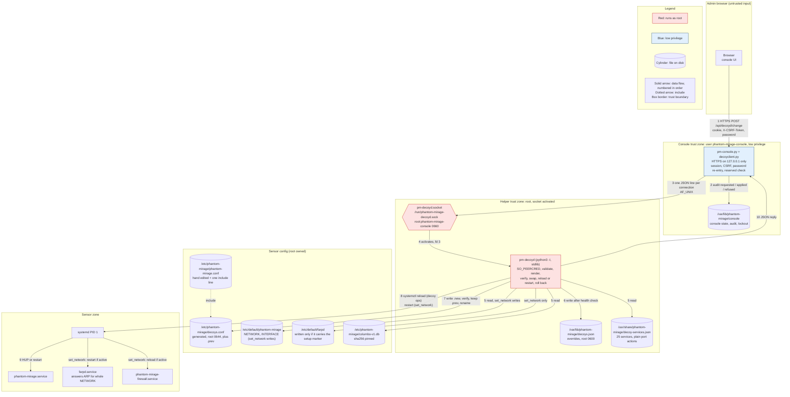

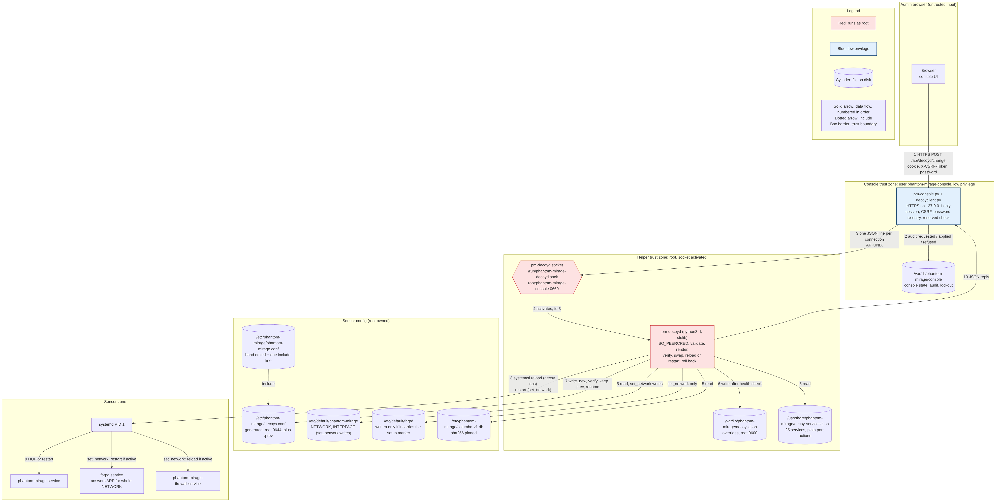

Source: [img/src/01-architecture.mmd](img/src/01-architecture.mmd)

### Components

| Component | What it is | Status |
|---|---|---|
| `pm-console.py` + `decoyclient.py` | Console web server (user phantom-mirage-console). Decoy routes `GET /api/decoyd/list`, `/api/decoyd/options`, `/api/decoyd/netinfo` and `POST /api/decoyd/change` (client timeout 90 s, 240 s for set_network). Also `GET /api/timezones`, `POST /api/settings` (timezone), `POST /api/password`, Dashboard and Activity UI. Every POST needs `X-CSRF-Token`. | Implemented (PR 256), tested offline |
| `pm-decoyd.socket` | `ListenStream=/run/phantom-mirage-decoyd.sock`, `SocketUser=root`, `SocketGroup=phantom-mirage-console`, `SocketMode=0660`, `Accept=no` | Implemented (PR 256), untested on a real host |
| `pm-decoyd.service` | Runs `/usr/bin/python3 -I /usr/lib/phantom-mirage/pm-decoyd` as root. Refuses to start unless systemd passed exactly one socket (fd 3). Exits after 30 s with no connection. | Implemented (PR 256), untested on a real host |
| `/usr/lib/phantom-mirage/pm-decoys-include` | Postinst script: creates `/etc/phantom-mirage/decoys.conf` with a header if missing, appends `include /etc/phantom-mirage/decoys.conf` to phantom-mirage.conf once, after a backup to `phantom-mirage.conf.pre-decoys.bak`. Refuses symlinked config. | Implemented (PR 256), tested offline (ci/test_decoys_include.sh) |
| `/usr/lib/phantom-mirage/pm-decoyd-socket` | Postinst script: when the console is enabled (or the socket already is), enables and restarts the socket and stops an old helper. A failing systemctl does not fail the install. | Implemented (PR 256), tested offline with a fake systemctl (ci/test_decoyd_socket.sh) |
| `/usr/share/phantom-mirage/decoy-services.json` | 25 services, each an id, label, proto, port and a plain action `open`. No scripts. | Implemented (PR 256) |
| `/var/lib/phantom-mirage/decoys.json` | Helper store: `{v:1, overrides:{ip:{rev, state, decoy}}, conf_sha256}`, root 0600 | Implemented (PR 256) |
| `/etc/phantom-mirage/decoys.conf` | Generated from the store, root 0644, with `decoys.conf.prev` kept | Implemented (PR 256) |
| `/var/lib/phantom-mirage/netchange.journal` | Written by set_network after the `.prev` copies and before the first file is replaced; lists each file, whether it existed and its mode; removed when the change ends. If found at helper start or at the start of any change, the listed files are put back from `.prev` (or removed if they did not exist), the outcome `interrupted` is recorded and the sensor restarted if active. Paths outside the four fixed files are refused. Mode 0600. | Implemented (PR 256), tested offline |
| `/var/lib/phantom-mirage/netchange.last` | Outcome of the last set_network: `id`, `result` (applied, applied_not_running, rolled_back, rollback_failed, interrupted), `network`, `interface`, `previous`, `dropped`, `time`. Returned by netinfo as `last_change`. Not written when a change is refused before any file changes. Mode 0644. | Implemented (PR 256), tested offline |

### Trust boundaries

1. **Browser to console.** Existing login, session cookie and `X-CSRF-Token`. New: password re-entry on every change, with back off after wrong passwords. The console also refuses network and broadcast addresses before calling the helper.
2. **Console to helper.** The socket is root:phantom-mirage-console 0660, and the helper checks `SO_PEERCRED` and refuses any uid other than the console user (`E_PEER`). Everything the console sends is checked again by the helper. The helper never trusts the console's checks.
3. **Helper to sensor.** The helper writes only fixed paths, verifies with the real daemon, and talks to systemd with `systemctl`.

### Helper unit hardening (as written in PR 256)

`NoNewPrivileges`, `ProtectSystem=strict` with `ReadWritePaths=/etc/phantom-mirage /var/lib/phantom-mirage /etc/default`, `ProtectHome`, `PrivateTmp`, kernel and control group protections, `IPAddressDeny=any`, `RestrictAddressFamilies=AF_UNIX AF_INET AF_INET6 AF_PACKET AF_NETLINK`, `MemoryDenyWriteExecute`, `SystemCallFilter=@system-service`, `UMask=0077`, `CapabilityBoundingSet=CAP_NET_RAW`.

Two things differ from the first draft of this design:

- There is **no** `PrivateNetwork`, and `CAP_NET_RAW` is kept, because `--verify-config` opens the interface. Network access is limited by `IPAddressDeny=any` instead.
- `/etc/default` is writable as a whole directory, because set_network rewrites `/etc/default/phantom-mirage` and maybe `/etc/default/farpd`. This was already in the unit at 8a4cbe6; it is not new in 55c914d.

Whether this unit can really run `systemctl reload` and `restart`, and open the interface for verify, under these settings has **not** been checked on a real host.

### Generated config model

The main config keeps its hand written templates and binds and gains one line, `include /etc/phantom-mirage/decoys.conf`. The helper writes decoys.conf from the store only. For each override, in address order:

- **Running:** template `pm_d_<ip with underscores>`, for example `pm_d_192_0_2_9`. `set ... personality "<name>"` if one is chosen, `set ... default tcp|udp|icmp action <state>`, then one `add ... <tcp|udp> port <N> <action>` per port. A service entry is written as its fixed action from the service list, never as a command.
- **Stopped:** template `pm_s_<ip>` with `default tcp`, `udp` and `icmp action block` and no personality and no ports.
- Then `bind <ip> <template>`.

The helper keeps the sha256 of the text it last wrote. If decoys.conf on disk no longer matches, every change except reset_all (and set_network too) is refused with `E_CONFLICT`. The message tells you to drop the hand edits and all console decoy settings by running `sudo rm /var/lib/phantom-mirage/decoys.json` on the sensor and trying again. With no store there is no hash to compare, so the next change rewrites decoys.conf. reset_all also clears the conflict but is still not in the console UI.

## 3a. Related console surface on the same branch

These features are not the decoy helper. They live entirely in `pm-console.py` and the static UI on PR 256 (and, for theme toggle, earlier on the stack that includes PR 255). They matter for decoy work because the same session, CSRF and password rules protect every change, including decoy and network changes.

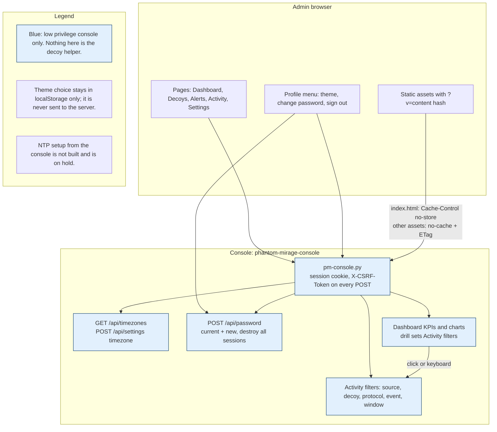

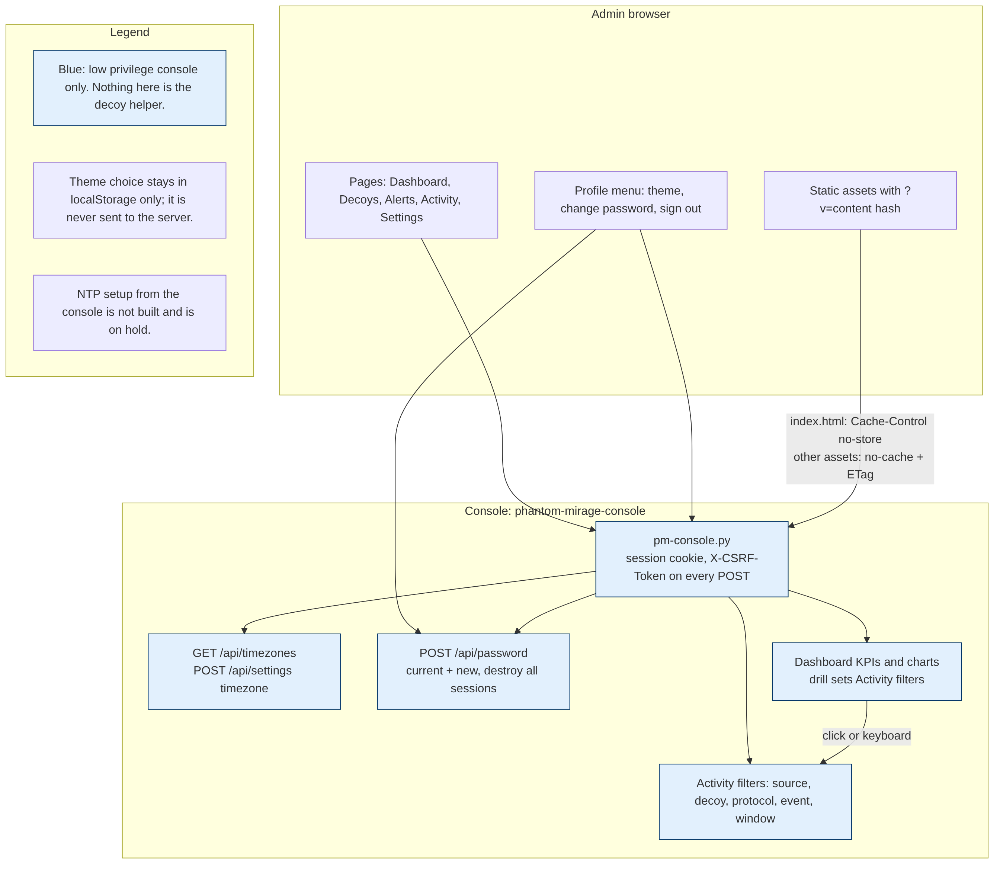

Source: [img/src/08-console-surface.mmd](img/src/08-console-surface.mmd)

### Dashboard

Implemented (PR 256), tested offline. Untested on a real host and in Safari.

- Landing page after sign in. Live refresh updates counters and charts in place.
- KPI cards: events in the last hour, open alerts, active decoys (non reserved), distinct sources in the last hour.
- Charts: connections over the last hour in 5 minute buckets (with hover, focus and tap readout), protocol split, busiest decoys, top source addresses.
- Drill down (mouse or keyboard): a KPI or chart part opens Activity with matching filters, or opens Alerts or Decoys. A time bucket sets a clearable window chip on Activity.

### Activity filters

Implemented (PR 256), tested offline.

- Filters: source IP (search, 200 ms debounce, Enter applies), decoy, protocol (TCP, UDP, ICMP), event type, and an optional time window from a Dashboard drill.
- Live refresh updates the table, the live label, the decoy list and the event type options only. It does not rebuild the source search box, so focus and keystrokes are kept.
- Pause, clear filters, and CSV export stay as before.

### Profile menu, password change and theme

Implemented (PR 256), tested offline. Theme toggle itself was already on the stack (PR 255 and earlier); 4f4fa81 only hosts it in the profile menu as well as on the sign in page.

- Profile row at the bottom of the sidebar: initials, user name, sensor name. Menu: theme, Change password, Sign out.
- Theme: light or dark, stored under `pm_theme` in localStorage only. Nothing about the theme is sent to the server. With no saved choice the CSS follows `prefers-color-scheme`.
- Change password opens a modal dialog that lives in `index.html` outside `#main`, so a live refresh cannot rebuild or close it. Fields: current password, new password, confirm. Client checks the two new values match; the server checks the current password, runs `password_problem` (at least 12 characters, not the username, not too simple, not too long), stores a new hash, destroys every session for that user, audits the change, and returns ok. The page then reloads to the sign in screen. Wrong current password is 403. The dialog also points at `phantom-mirage-setup --reset-admin` for recovery on the sensor.
- Sign out calls `POST /api/logout` (CSRF protected) and reloads.
- Every POST, including `/api/password`, `/api/settings`, `/api/logout` and `/api/decoyd/change`, must carry a valid `X-CSRF-Token` for the session or the console answers 403 and audits `csrf-reject`.

### Time zone selector

Implemented (PR 256), tested offline.

- `GET /api/timezones` (session required) returns a sorted list of IANA names this host can resolve, always including UTC, and never the `posix/` or `right/` trees. Offline tests see more than 300 zones when `zoneinfo` is present.
- Settings shows a drop down of those zones. `POST /api/settings` with `timezone` must match `^[A-Za-z0-9_+\-/]{1,64}$`. When more than one zone is known, the value must also be in the list; otherwise 400. Saving updates the config, audits the change, and the UI applies the zone live to times across the console.
- The Settings card still shows the configured time source (browser at sign in, or an NTP server string written by setup). Changing NTP from the console is **not started** and is on hold. Do not treat the display of an existing `time_source` value as an NTP feature in this work.

### Cache safe static assets

Implemented (PR 256), tested offline.

- `index.html` is branded and served with `Cache-Control: no-store`. Script, style and image URLs carry `?v=<12 hex chars>`, a short sha256 of every static file other than `index.html`.
- Other static responses use `Cache-Control: no-cache` and a content `ETag`. An `If-None-Match` match returns 304. An upgrade therefore cannot leave a new page talking to a stale `console.js` or `console.css`.

### Branding note

The product logo wordmark in the header is now a bold uppercase vector (still themed). MIRAGE stays centred in the sidebar. Gateways are listed once. Implemented (PR 256), tested offline (branding tests).

## 4. Data flow diagrams

### 4.1 Decoy change (add, edit, stop, start, reset to default)

Implemented (PR 256), tested offline with a fake systemctl and fake daemon. Untested on a real host.

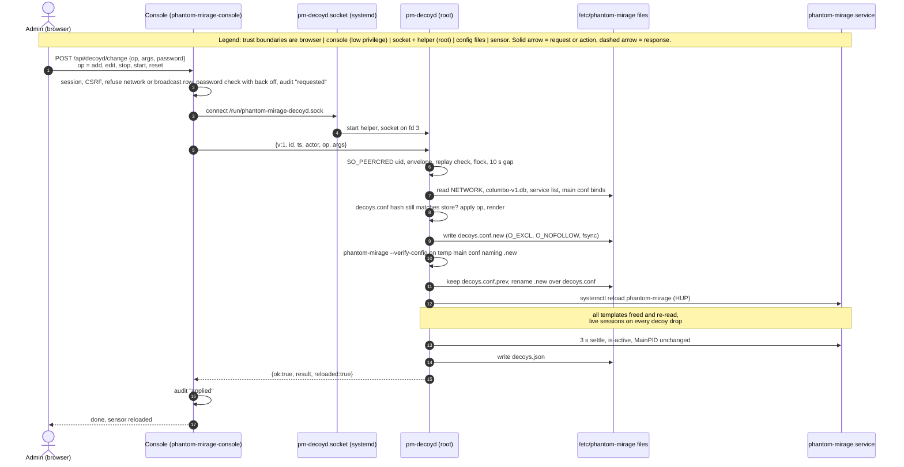

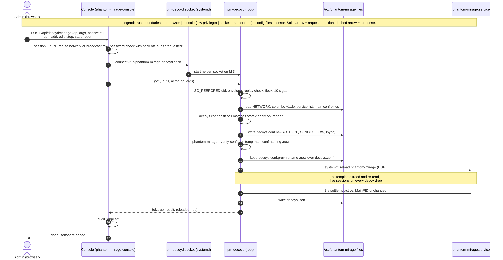

Source: [img/src/02-change-flow.mmd](img/src/02-change-flow.mmd)

### 4.2 Decoy change failure and rollback

Implemented (PR 256). Rollback paths tested offline (daemon died, new MainPID, reload rc, rollback failed, no previous file). Untested on a real host.

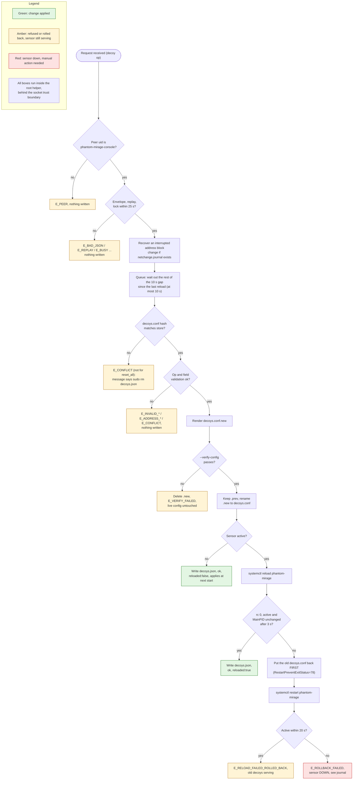

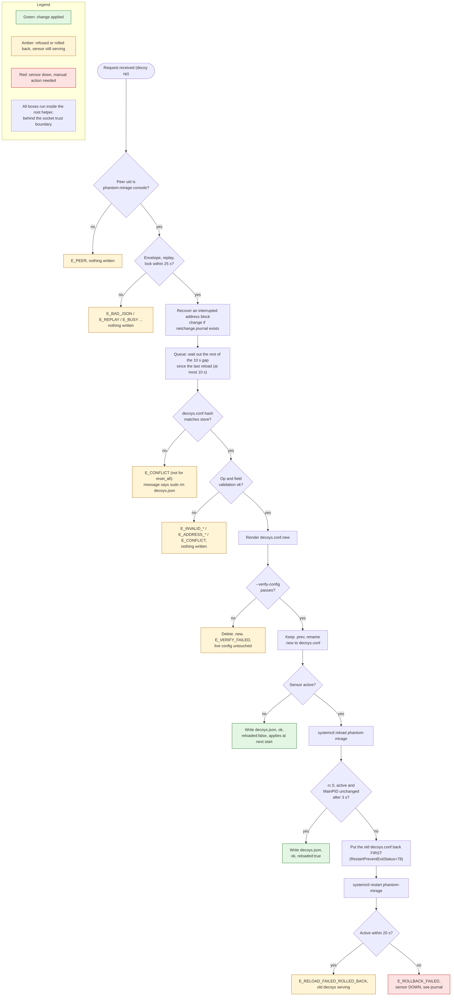

Source: [img/src/03-rollback.mmd](img/src/03-rollback.mmd)

### 4.3 Stop by drop template

Rendering implemented (PR 256) and checked by golden output tests. The packet behaviour shown here (no reply while ARP is still answered) has **not** been tested on a real LAN.

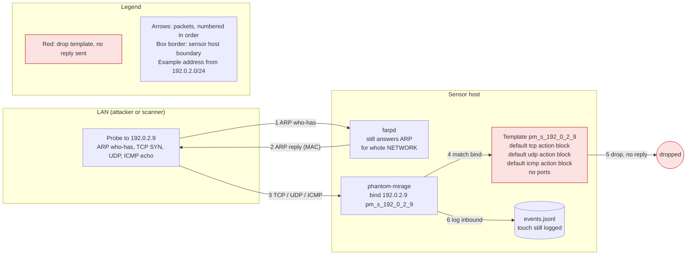

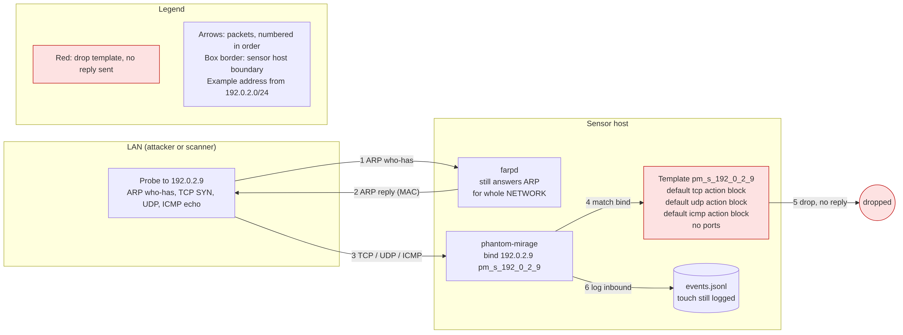

Source: [img/src/04-stop-drop.mmd](img/src/04-stop-drop.mmd)

### 4.4 Socket activation lifecycle

Implemented (PR 256): the helper exits after 30 s idle and refuses to start without `LISTEN_FDS=1`. Offline tests use a socket pair. Real socket activation is untested.

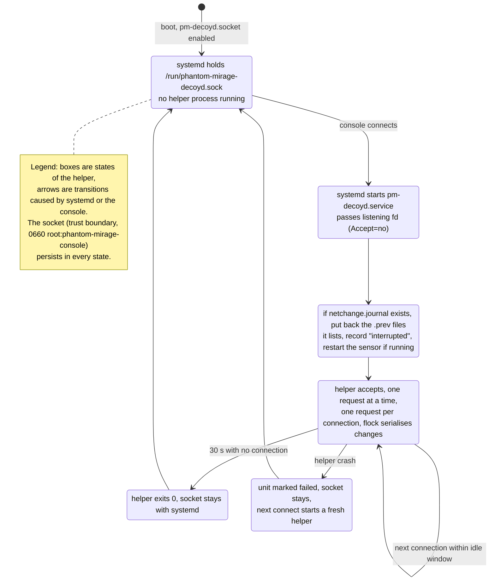

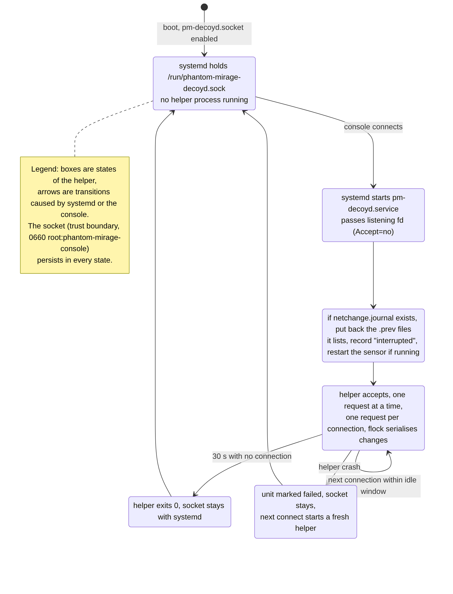

Source: [img/src/05-socket-lifecycle.mmd](img/src/05-socket-lifecycle.mmd)

### 4.5 Address block change (set_network)

Implemented (PR 256), tested offline with a fake systemctl, fake `ip` output and a fake daemon. Untested on a real host.

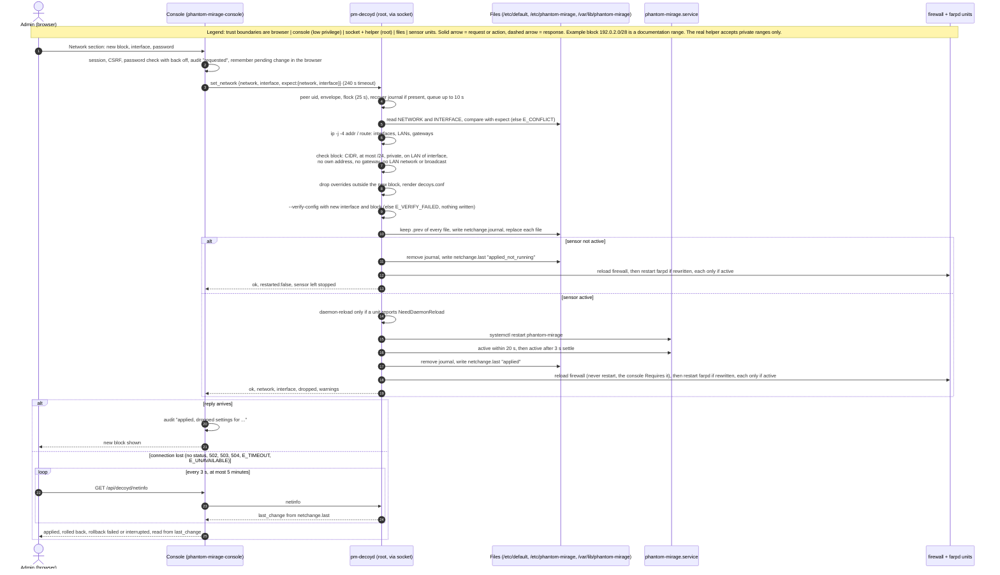

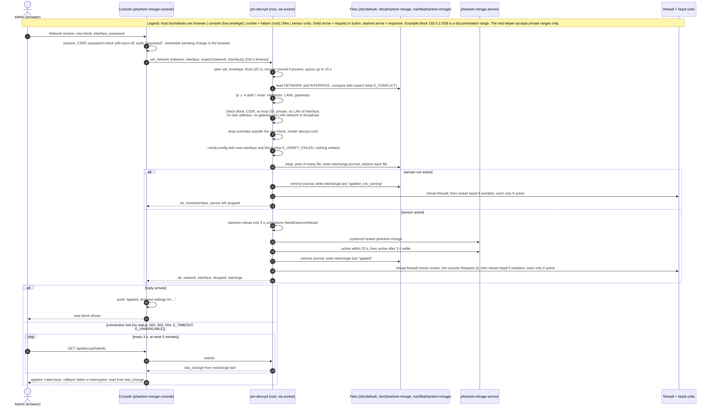

Source: [img/src/06-set-network.mmd](img/src/06-set-network.mmd)

### 4.6 Address block change rollback

Implemented (PR 256). Offline tests check that a failed restart puts every file back and that the old `/etc/default/phantom-mirage` is in place before the second restart; that a failed rollback gives `E_ROLLBACK_FAILED` with the files restored; and that a failed verify writes nothing and restarts nothing. Untested on a real host.

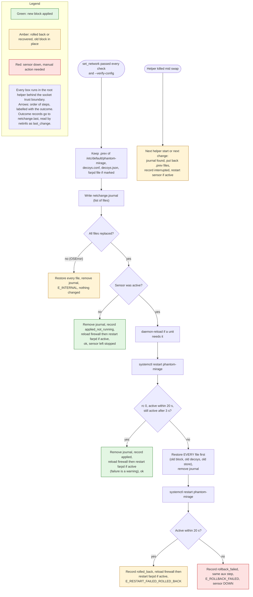

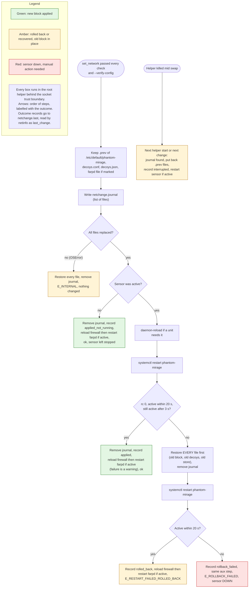

Source: [img/src/07-set-network-rollback.mmd](img/src/07-set-network-rollback.mmd)

## 5. Message format (typed JSON over the unix socket)

### 5.1 Framing

One request per connection: one JSON line in, one JSON line out. Requests over 16384 bytes, or not finished within 5 s, get `E_BAD_JSON`. Replies are capped at 1 MiB by the client.

### 5.2 Envelope

Request: `{"v":1, "id":"<1 to 64 of A-Z a-z 0-9 ->", "ts":<unix seconds>, "actor":"<1 to 64 of A-Z a-z 0-9 . _ ->", "op":"<op>", "args":{...}}`

- `v` must be 1 (`E_VERSION`). Unknown fields give `E_UNKNOWN_FIELD`; duplicate keys give `E_BAD_JSON`.
- `ts` must be within 60 s of the helper's clock, and an `id` may not be reused within 600 s (`E_REPLAY`). Seen ids are kept in `/run/phantom-mirage-decoyd/seen.json` so they survive a helper restart.

Reply: `{"v":1, "id", "ok":true|false, "reloaded":bool, "rolled_back":bool, "result":{...}}` or, on failure, `"error":{"code", "field", "message"}`. Tracebacks are never sent.

### 5.3 Operations

| Op | Args | Result | Status |
|---|---|---|---|
| `list` | none | `network`, and one entry per address with `source` override, default or main_conf | Implemented |
| `options` | none | personalities, states, services (id, label, proto, port), `max_ports` 64 | Implemented |
| `netinfo` | none | current network and interface, interfaces with addresses, gateways (each listed once, sorted), `last_change` (the outcome record or null), `min_prefix` 24 | Implemented |
| `add` | `decoy` | `ip`, `state` running, `rev` 1 | Implemented |
| `edit` | `decoy`, `expect_rev` (required) | new `rev` | Implemented |
| `stop` | `ip`, `expect_rev` if an override exists | `state` stopped, `arp` "still_answered" | Implemented |
| `start` | `ip`, `expect_rev` | running; a stop on a default decoy is simply removed | Implemented |
| `reset` | `ip`, `expect_rev` | removes the override so the address is back on the default template | Implemented (renamed from `delete` in f09ce88) |
| `reset_all` | `confirm` = "reset-all" | `overrides` 0 | Implemented in the helper; not exposed in the console UI as far as I could see |
| `set_network` | `network`, `interface`, `expect:{network, interface}` | `network`, `interface`, `dropped`, `farpd`, `restarted`, maybe `warnings` | Implemented |

**Note on `reset`.** The op formerly called `delete` is now `reset` in the helper, the client and the console. The console uses it for the "Use default template" button. It does **not** take an address out of service. There is no `delete` op any more; deleting a decoy in that sense is not started (section 10).

A `decoy` object has exactly `ip`, `personality` (a name or null), `defaults` `{tcp, udp, icmp}` and `ports`, a list of `{proto, port, state}` or `{proto, port, service}`.

### 5.4 Error codes

| Group | Codes | Console HTTP status |
|---|---|---|
| Transport (client side) | `E_UNAVAILABLE`, `E_TIMEOUT`, `E_BAD_REPLY` | 503 |
| Envelope | `E_PEER` (500), `E_BAD_JSON`, `E_VERSION`, `E_UNKNOWN_FIELD`, `E_MISSING_FIELD`, `E_TYPE`, `E_REPLAY`, `E_UNKNOWN_OP` | 400 unless shown |
| Queue | `E_BUSY` (lock not free within 25 s) | 429 |
| Decoy validation | `E_INVALID_ADDRESS`, `E_ADDRESS_OUTSIDE_NETWORK`, `E_ADDRESS_RESERVED`, `E_ADDRESS_IN_MAIN_CONF`, `E_INVALID_PERSONALITY`, `E_INVALID_STATE`, `E_INVALID_PORT`, `E_INVALID_SERVICE`, `E_TOO_MANY_PORTS` | 400 |
| State | `E_CONFLICT`, `E_EXISTS`, `E_NOT_FOUND`, `E_NOT_RUNNING`, `E_NOT_STOPPED`, `E_UNCHANGED` | 409 |
| Network validation | `E_INVALID_NETWORK`, `E_NETWORK_TOO_WIDE`, `E_NOT_PRIVATE`, `E_INVALID_INTERFACE`, `E_NOT_ON_LAN`, `E_HOST_ADDRESS`, `E_GATEWAY`, `E_LAN_EDGE` | 400 |
| Apply | `E_VERIFY_FAILED` (400), `E_RELOAD_FAILED_ROLLED_BACK`, `E_RESTART_FAILED_ROLLED_BACK`, `E_ROLLBACK_FAILED`, `E_INTERNAL` | 500 unless shown |

The console itself answers 403 for a wrong password, 423 while backing off after wrong passwords, and 400 `E_ADDRESS_RESERVED` for a network or broadcast address.

`E_RATE_LIMIT` is removed from the helper, the console status mapping and the UI messages. A change that comes within 10 s of the last reload now waits out the rest of that gap, never more than 10 s even if the clock moved back. This 10 s is on top of the wait for the lock, which can still take up to 25 s and give `E_BUSY`.

## 6. Validation rules (as coded)

Decoy fields

- `ip`: canonical dotted IPv4, inside NETWORK, not bound in the main config, and not the network or broadcast address of its block when the block is /30 or wider. /31 and /32 have no reserved address.
- `personality`: matches `[A-Za-z0-9._+-]{1,64}` and is a `Fingerprint` name in `/etc/phantom-mirage/columbo-v1.db`. The file's sha256 must match `columbo-v1.db.sha256` or every change fails.
- `defaults` and port `state`: one of open, closed, reset, block, filtered.
- `ports`: at most 64, proto tcp or udp, port 1 to 65535 as an integer, no duplicate proto and port, exactly one of `state` or `service`. A service must exist in the list and use the same proto.
- Strings from root owned lists are checked against control characters, quotes, `#` and backslash.

Address block (set_network)

- `expect` must equal the current NETWORK and INTERFACE, else `E_CONFLICT`.
- `network` written as `a.b.c.d/n`, the exact start of a block (host bits give a hint with the right start), at most /24 (no wide block switch in the console), inside 10.0.0.0/8, 172.16.0.0/12 or 192.168.0.0/16.
- `interface` matches `[A-Za-z0-9_.-]{1,15}`, exists in /sys/class/net, is not loopback, has an IPv4 address.
- The block is inside the LAN of that interface, holds none of the host's own addresses, no default gateway, and not the LAN's network or broadcast address.
- The same values are unchanged gives `E_UNCHANGED`.
- `/etc/default/phantom-mirage` must have exactly one `NETWORK=` and one `INTERFACE=` line. Only those two lines are rewritten. `/etc/default/farpd` is rewritten only if its first line is `# written by phantom-mirage-setup`.

Documentation example addresses (192.0.2.0/24, 198.51.100.0/24, 203.0.113.0/24) are used in this document only. The real helper refuses them as a block with `E_NOT_PRIVATE`.

## 7. Failure handling and rollback

Decoy changes (section 4.2). Before anything else, a leftover `netchange.journal` is recovered (section 3) and the 10 s queue wait runs.

1. Write `decoys.conf.new` with `O_EXCL|O_NOFOLLOW`, fsync.
2. Verify: copy the main config to `/etc/phantom-mirage/.pm-decoyd-verify.conf` with its one include line pointing at `.new`, then run `phantom-mirage --verify-config -f <temp> -p columbo-v1.db` with the same data files and interface and block. Failure deletes `.new` and gives `E_VERIFY_FAILED` with the parser's first useful line.
3. Keep `decoys.conf.prev`, rename `.new` over decoys.conf, fsync the directory.
4. If the sensor is not active, write the store and stop: the file is used at next start.
5. Otherwise `systemctl reload phantom-mirage.service`, wait 3 s, and require rc 0, active, and the same MainPID.
6. On failure, put the old decoys.conf back **before** `systemctl restart`, because the unit has `RestartPreventExitStatus=78` and a restart onto the bad file could stop it for good. Wait up to 20 s for active: `E_RELOAD_FAILED_ROLLED_BACK`, or `E_ROLLBACK_FAILED` if it stays down. The store is only written after a good reload.

Address block change (section 4.6)

1. All checks and `--verify-config` with the new interface and block run before any file is written.
2. Keep `.prev` of `/etc/default/phantom-mirage`, decoys.conf, decoys.json and the farpd file if it is rewritten, write `netchange.journal`, then replace each. A write error restores all files, removes the journal and gives `E_INTERNAL` (no outcome is recorded for this case).
3. A stopped sensor is left stopped; the outcome `applied_not_running` is recorded.
4. Otherwise run `systemctl daemon-reload` if the sensor or firewall unit reports `NeedDaemonReload=yes` (the helper never writes unit files; this covers a unit changed on disk without a reload), restart the sensor, wait up to 20 s for active and check again after 3 s. The outcome `applied` is recorded.
5. On failure restore **every** file first, remove the journal, restart the sensor, wait up to 20 s, and record `rolled_back` or `rollback_failed`, giving `E_RESTART_FAILED_ROLLED_BACK` or `E_ROLLBACK_FAILED`.
6. In every case above after the swap, the aux step runs: the firewall is **reloaded** (`ExecReload` runs `pm-firewall apply`) and then farpd is restarted if its file was rewritten, each only if it is already active. Failures there are warnings. The firewall is not restarted because `phantom-mirage-console.service` has `Requires=phantom-mirage-firewall.service`, so a restart also restarted the console and cut the request and every session.

The daemon-reload check runs only before the first restart in step 4. It does not run before a decoy reload, before the rollback restart, or for the farpd unit.

The file swap is still a series of single file renames, not one atomic step. A crash part way through is now covered by the journal: the next helper start or change puts the `.prev` set back and records `interrupted`. Journal recovery restarts only the sensor, not the firewall or farpd. This is tested offline only (a simulated crash mid swap).

## 8. Threat model

| Threat | Mitigation (PR 256) | Residual risk |
|---|---|---|
| Privilege escalation from a compromised console | Typed JSON only; helper rechecks everything; no free text reaches config; hardened unit | A compromised console can make any allowed change, including moving the address block within the LAN and restarting the sensor. Bugs in the helper's Python parsing are root bugs. |
| Stolen session | Password re-entry on every change, with back off | A stolen session plus the password still works. |
| Injection into config | Template names built from the address; personality and actions checked against fixed lists; only `NETWORK=` and `INTERFACE=` lines rewritten with validated values | A malicious entry in the service list or personality file would be used; both are root owned and the db is sha256 pinned. |
| Symlink and race on swap | `O_EXCL|O_NOFOLLOW`, rename in the same directory, refuses non root owned or symlinked config | `/etc/default` is writable to the helper as a whole directory. |
| Socket permissions | 0660 root:phantom-mirage-console, `SO_PEERCRED` | Anything running as the console user is trusted the same. |
| Denial of service by reloads | flock, changes queue behind a 10 s gap between reloads | The console can still reload every 10 s or restart the sensor with set_network. |
| Replay | `ts` window 60 s, `id` kept 600 s on /run, `expect_rev` and `expect` | Mainly stops double submits. |
| Address block moved onto live hosts | Must be private, at most /24, on the LAN of the interface, no own address, no gateway, no LAN edge | **No probe for other live hosts in the new block.** farpd would answer ARP for them. This is the biggest open risk of set_network. |
| Bad config takes sensor down | Verify first, health check, restore before restart | If the restored files also fail, the sensor stays down: `E_ROLLBACK_FAILED`. |
| Manual edit of decoys.conf | Hash check, `E_CONFLICT`; the message names `sudo rm /var/lib/phantom-mirage/decoys.json` | Recovery needs a shell on the sensor and drops every console decoy setting, not only the hand edits. |
| Audit gaps | Console audit requested, applied or refused, with dropped addresses; helper logs request, decision and diff to syslog | Console audit can be altered by a compromised console; the journal copy is stronger. |

## 9. Test plan and what has been run

Run offline on PR 256 head 4f4fa81 (by me, for this update)

- `python3 -m unittest discover -s decoyd/tests`: 65 tests, all pass, 3 skipped (`TestRealVerify`, need root and the built daemon). No decoyd code changed since 55c914d.
- `python3 -m unittest discover -s console/tests`: 163 tests pass (was 141 at 55c914d). New coverage includes Dashboard page and drill down, Activity event filter and live safe refresh, profile menu, password dialog placement, chart hover readout, `/api/timezones` and timezone validation, timezone drop down markup, and cache safe assets after an upgrade.
- `ci/test_decoys_include.sh` and `ci/test_decoyd_socket.sh`: pass.

What the offline tests cover: validation tables, envelope and replay, rendering, the decoy change pipeline and its rollbacks, network validation, set_network success, rollback, outcome record and journal recovery, socket peer checks with a socket pair. All with a fake `systemctl`, fake `ip` output and a fake daemon.

One manual test on a real host (reported by the project owner, not repeated by me)

- On one test machine the project owner changed the address block from the console (for example from 192.0.2.0/28 to 192.0.2.16/28; the real addresses are not given here). The change applied and the sensor came up on the new block.
- During that change the console dropped. That was the firewall restart taking the console with it; the code now reloads the firewall instead. The fixed version has not been retested on a real host as far as I know.
- This is one manual run of one path. It is not a real systemd test matrix.

Still needed, only on a real systemd host

- Socket activation, socket owner and mode, `SO_PEERCRED` from the real console user, idle exit.
- Whether the hardened unit can call `systemctl reload` (SIGHUP under the hardened unit), `restart` and `daemon-reload` and open the interface for verify. The one manual run suggests restart works for set_network; nothing else is shown.
- Real decoy reload and its rollback, and real restart rollback, including `ExecStartPre` checks.
- Real firewall reload keeping the console and its sessions up during set_network (the fix after the manual test).
- The console's 5 minute wait after a lost connection, against a real restart.
- Journal recovery after a real crash or kill mid swap.
- Stopped decoy behaviour on a real LAN: no reply while a neighbour answers, ARP still answered.
- farpd on a real LAN: restart and ARP for the new block, old block released.
- Package install and upgrade: the include line, the socket enable, and a postinst upgrade that hits a conffile prompt, on a real system.
- Safari (and other non Chromium browsers): Dashboard charts, drill down, profile menu, password dialog, time zone drop down and cache safe asset load.

## 10. Build slices

| Slice | Delivers | Status |
|---|---|---|
| 1 Read only groundwork | Personality list, per decoy detail panel, `parse_decoys` keeps port states | Implemented (PR 256) |
| 2 Helper and include | pm-decoyd, socket and service units, include script, service list | Implemented (PR 256), tested offline |
| 3 Stop and start | Stop and Start icons per row; none on network and broadcast rows | Implemented (PR 256), tested offline |
| 4 Settings panel | Personality, default actions, port table, "Use default template" (op `reset`). The panel note now says the address block is changed in the Network section, and that addresses bound in phantom-mirage.conf are changed there. | Implemented (PR 256), tested offline |
| 5 Network section | Change address block and interface (set_network), outcome after a lost connection | Implemented (PR 256), tested offline, one manual real host run |
| Console look | Bold uppercase product wordmark (vector, themed) in the header, MIRAGE centred in the sidebar, gateways listed once | Implemented (PR 256), tested offline (branding tests) |
| Console Dashboard and Activity | Dashboard charts with drill down; Activity event filter and live safe refresh | Implemented (PR 256), tested offline; untested on a real host and in Safari |
| Console account | Profile menu with theme, change password (destroys sessions) and sign out; time zone drop down via `/api/timezones` | Implemented (PR 256), tested offline |
| Console asset cache | `?v=` content hash, `no-store` HTML, `no-cache` + ETag assets | Implemented (PR 256), tested offline |
| NTP from the console | Configure or change NTP in the UI | **Not started.** On hold. The Settings card may show an existing time source string from setup; that is display only. |
| 6 Delete a decoy | Take an address out of service | **Not started.** Later slice, one change at a time. |

Every slice still needs security review sign off and a real host test before merge.

## 11. Open questions

Decided

- Helper in Python, socket activated, typed JSON.
- Stop means a drop template with ARP still claimed.
- Every decoy change reloads all decoys; a block change restarts the sensor.
- Fixed service list with plain actions, no commands.
- The address block is editable from the console (Network section).
- Password re-entry on every change (implemented in PR 256).
- Network and broadcast addresses of the block cannot be decoys and show no Stop or Start (reserved).

Still open

1. **Delete a decoy**: what it means (stop and hide, remove from the block, or shrink the block) and when. Not started.
2. **Live host probe for set_network**: there is no check that the new block is free of real hosts.
3. **Wide and multiple blocks**: the console allows one private block of /24 or smaller only. Should `ALLOW_WIDE_NETWORK` ever be offered?
4. **Recovery from a hand edited decoys.conf**: `sudo rm decoys.json` drops every console setting. Is a gentler path wanted, for example reset_all in the UI?
5. **`/etc/default` write access**: the helper can write the whole directory. Could it be narrowed to the two files?
6. **Journal recovery scope**: it restarts the sensor only, not the firewall or farpd, and a write error before the restart records no outcome.
7. **Display label** for a decoy.
8. **NTP from the console**: on hold. When (if) it returns, how it interacts with the browser time source and the drift warning.

Resolved since the first draft

- The `parse_decoys` bug on master (it listed every port as `tcp/port` and compared the port number against state names) is **fixed on PR 256**: it now reads the port from `w[4]` and the state from `w[5]`, and adds a `port_states` list. There is also a separate commit "Decoys page shows tcp/22 instead of tcp/port" on the branch.
- Verify with a temp main config whose include names the candidate file: implemented as described.
- Name of the `delete` op: renamed to `reset` (f09ce88).
- `E_RATE_LIMIT`: removed; changes queue for at most 10 s behind the last reload.
- Recovery from `E_CONFLICT` without reset_all in the UI: the message now names `sudo rm /var/lib/phantom-mirage/decoys.json`.
- Multi file swap not atomic: still not atomic, but a crash mid swap is now recovered from `netchange.journal`.
- Console lost during an address block change: the firewall is reloaded, not restarted, and the UI reads the outcome from `last_change`.
- Change password moved out of Settings into the profile menu dialog (53ee5de).
- Static assets made cache safe after an upgrade (0a6a357).
