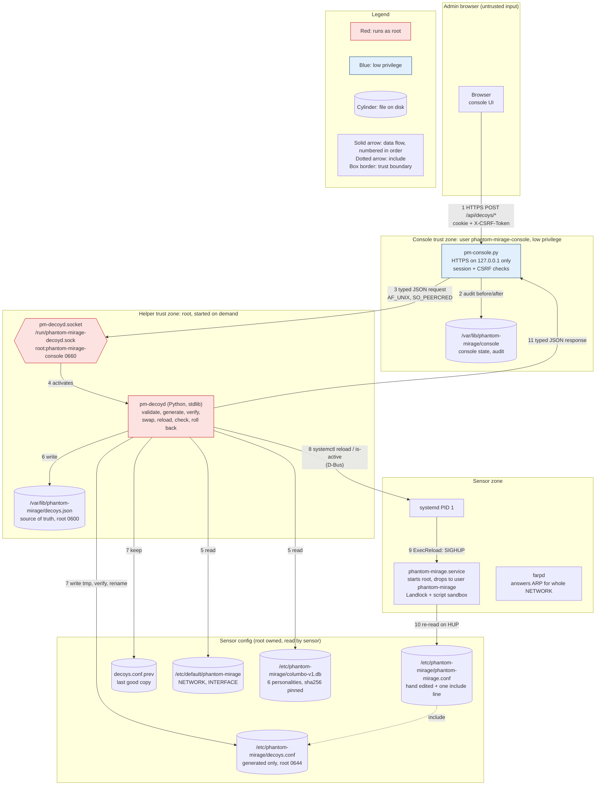
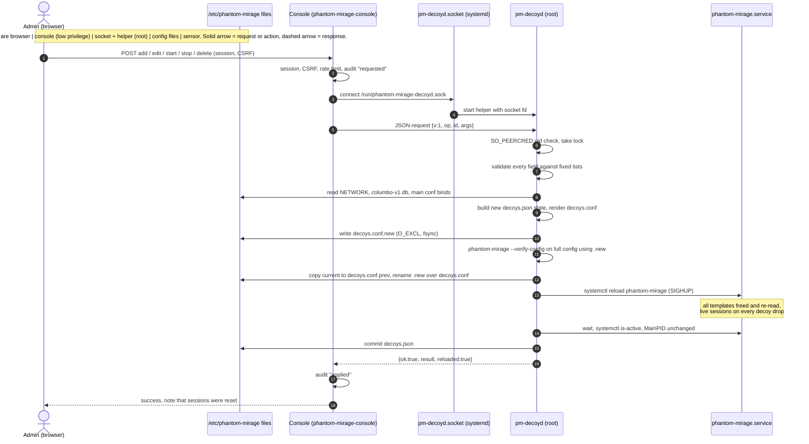
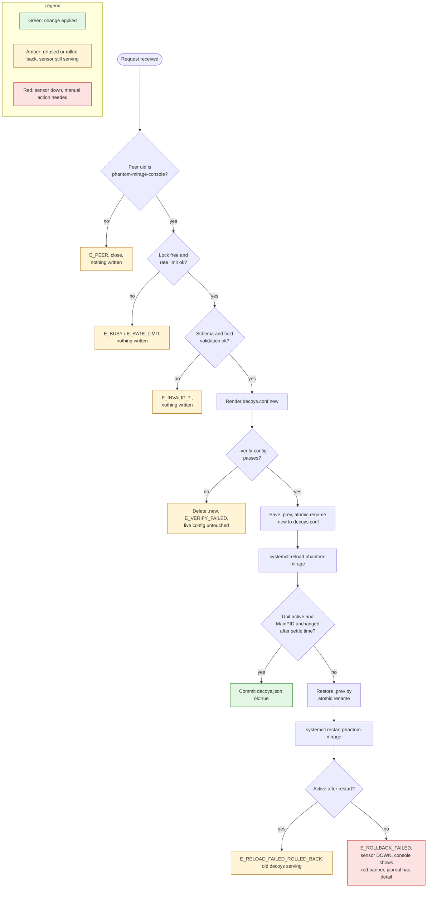
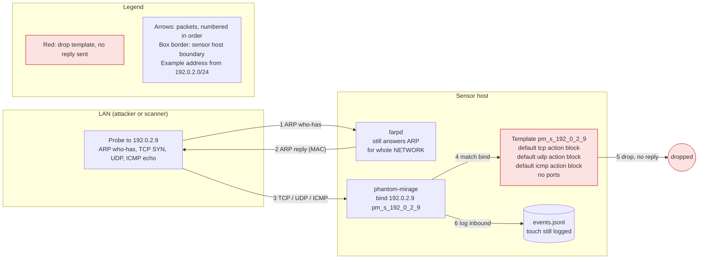
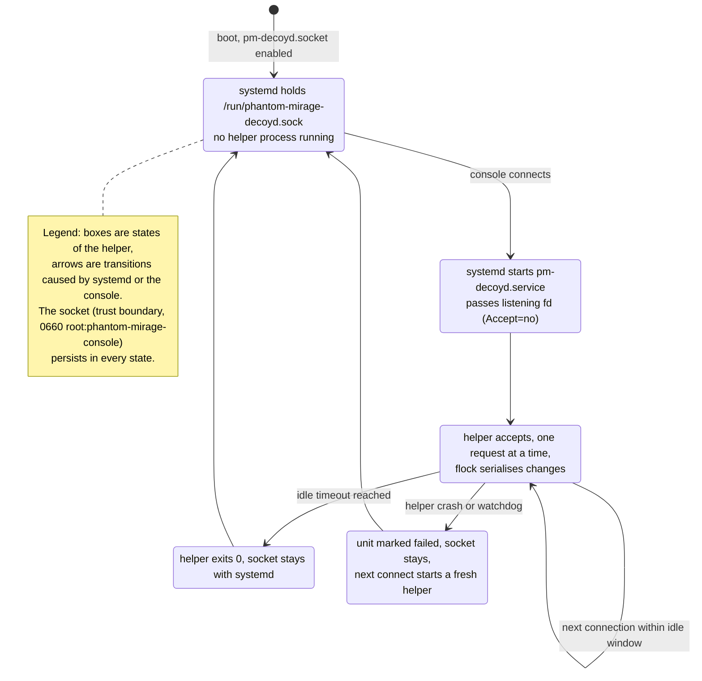

# Decoy management from the console: design

**Status: Design, draft, not yet implemented.** Nothing described here as new (the helper, its socket, decoys.conf, decoys.json, the new console screens) exists in the repository yet. Statements about current behaviour are taken from master at commit 9fca4ff and from the investigation notes, with file and line references so they can be checked.

## In short

- The console will let you change single decoys: give one its own operating system look, choose which services it shows, stop it, start it again, or put it back to the shared default.
- The console itself stays a low privilege program. A small separate helper, started only when needed, does the actual change after checking every value against fixed lists.
- If a change would break the sensor, the helper refuses it, or puts the old settings back and restarts the sensor.
- Every change briefly reloads all decoys, so anyone connected to any decoy at that moment is disconnected.
- "Stop" makes a decoy silent, but the address still appears on the network.
- Two points still need your decision: whether the address block stays read only in the console, and whether you must re-enter your password to make a change.

## 1. Overview (plain words)

**What it is.** Phantom Mirage pretends to be several computers on your network. These pretend computers are called decoys. Today all decoys share one setup, and changing anything means editing a configuration file by hand on the sensor and reloading it.

**What you will be able to do.** From the web console you will be able to:

- see each decoy's settings in detail;
- give a decoy its own personality, chosen from the 6 operating system profiles the sensor ships with;
- choose which services a decoy appears to offer, picked from a fixed list (for example "SSH" or "web server");
- stop a decoy so it no longer answers, and start it again;
- remove a decoy's own settings so it goes back to the shared default.

**What changes for you.**

- You no longer need to edit files on the sensor for these tasks.
- Each change takes a few seconds and reloads every decoy, so any connection an attacker has open to any decoy at that moment is cut. The console will warn you about this before you confirm.
- A stopped decoy goes quiet, but other machines can still see that something owns the address. To them it looks like a computer behind a firewall.

**What does not change.**

- The range of addresses the sensor covers is still set during setup, not from these new screens.
- You cannot type commands or file names anywhere. Only choices from fixed lists are accepted.
- The console keeps the same login, the same address (only on the sensor itself) and the same low privileges.
- The hand edited main configuration file stays yours. The new settings live in a separate generated file.

## 2. Goals and non-goals

Goals

- Per decoy override of personality, default protocol actions and ports, from the console.
- Per decoy stop and start without restarting the sensor.
- No new privilege for the console process; all config writing in one small, strict, auditable helper.
- A bad change must never leave the sensor down if the previous config still works.
- Every change audited in the console audit log and the system journal.

Non-goals

- Editing NETWORK or INTERFACE from the console (needs a full sensor restart and a farpd restart).
- Free form config text, free form script commands, or `proxy` lines (investigation notes, section 3: a proxy would make decoys relay traffic).
- Adding personalities beyond the 6 in columbo-v1.db (that needs a rebuilt, re-pinned db).
- Per decoy reload. The daemon has none: a SIGHUP frees every template (honeyd.c, `honeyd_sighup`, `template_free_all(TEMPLATE_FREE_REGULAR)` then `config_read`).
- Making a stopped address vanish from ARP (optional later slice, see section 10).
- IPv6 decoys.

## 3. Architecture and trust boundaries




### Components

| Component | Status | Runs as | Notes |
|---|---|---|---|
| Admin browser | exists | n/a | Untrusted input. Talks HTTPS to the console on 127.0.0.1 only. |
| `console/pm-console.py` (unit `debian/phantom-mirage-console.service`) | exists | `phantom-mirage-console` | `NoNewPrivileges=yes`, `ProtectSystem=strict`, `ReadWritePaths=/var/lib/phantom-mirage/console`, only `CAP_SYS_TIME`. Session cookie plus `X-CSRF-Token` check on POST (pm-console.py around line 257). Will gain new API routes and a socket client. |
| `console/pmstore.py` | exists | console user | `parse_decoys`, `decoy_list`, `audit`. Read only view of the config today. |
| `pm-decoyd.socket` | proposed | systemd | `ListenStream=/run/phantom-mirage-decoyd.sock`, `SocketUser=root`, `SocketGroup=phantom-mirage-console`, `SocketMode=0660`, `Accept=no`. |
| `pm-decoyd.service` and `/usr/lib/phantom-mirage/pm-decoyd` | proposed | root | Python 3, `python3 -I`, standard library only. Started by the socket, exits when idle. |
| `/var/lib/phantom-mirage/decoys.json` | proposed | root, 0600 | Source of truth for overrides. |
| `/etc/phantom-mirage/decoys.conf` | proposed | root, 0644 | Generated only. Never hand edited. Included by one line at the end of phantom-mirage.conf. |
| `/etc/phantom-mirage/decoys.conf.prev` | proposed | root, 0644 | Last known good copy for rollback. |
| `/etc/phantom-mirage/phantom-mirage.conf` | exists | root | Built from config.sample by `debian/mkconf.sh` (debian/rules line 32). Gains `include /etc/phantom-mirage/decoys.conf`. |
| `/etc/default/phantom-mirage` | exists | root | `INTERFACE`, `NETWORK`, `OPTIONS`. Parsed by `debian/scripts/pm-start` with the strict parser in `default-lib.sh`. |
| `/etc/phantom-mirage/columbo-v1.db` | exists | root | 6 `Fingerprint` entries, sha256 pinned (`fingerprints/columbo-v1.db.sha256`, checked by `pm_check_fpdb`). |
| `phantom-mirage.service` | exists | starts root, drops to `phantom-mirage` | `ExecStartPre=pm-start check`, `ExecStartPre=pm-start verify`, `ExecStart=pm-start run`, `ExecReload=+/bin/kill -HUP $MAINPID`, `Restart=on-failure`, `RestartPreventExitStatus=78`. |
| farpd | exists | separate service | Answers ARP for the whole NETWORK (written by `debian/scripts/phantom-mirage-setup`). Not touched by this feature. |

### Trust boundaries

1. Browser to console: HTTPS on loopback, existing login, session and CSRF checks.
2. Console to helper: the unix socket. Only members of group `phantom-mirage-console` can connect (mode 0660), and the helper also checks `SO_PEERCRED` uid equals the `phantom-mirage-console` user. The message is typed JSON; the console never sends config text.
3. Helper to config files: only the helper (root) writes `decoys.json`, `decoys.conf` and `.prev`. Its unit uses `ProtectSystem=strict` with `ReadWritePaths=/etc/phantom-mirage /var/lib/phantom-mirage` (narrowest that still allows an atomic rename in the directory), `PrivateNetwork=yes`, `NoNewPrivileges=yes`, empty `CapabilityBoundingSet` if systemctl over D-Bus works without capabilities (to be confirmed on a real host).
4. Helper to sensor: only through `systemctl reload|restart|is-active phantom-mirage` and `systemctl show -p MainPID`.
5. Sensor reads config after its privilege drop; investigation notes that the Landlock rules keep the config directory readable (honeyd.c, `sbd_dir(config.config, 0)`), so the include file must live in /etc/phantom-mirage.

### Generated config model

Template names are derived from the address only, never from user text. Example for 192.0.2.9 (running):

```
create pm_d_192_0_2_9
set pm_d_192_0_2_9 personality "ws2022-fwoff"
set pm_d_192_0_2_9 default tcp action reset
set pm_d_192_0_2_9 default udp action closed
set pm_d_192_0_2_9 default icmp action open
add pm_d_192_0_2_9 tcp port 22 "sh /usr/share/phantom-mirage/scripts/linux/ssh.sh"
add pm_d_192_0_2_9 tcp port 80 open
bind 192.0.2.9 pm_d_192_0_2_9
```

Stopped (drop template, proposed prefix `pm_s_`):

```
create pm_s_192_0_2_9
set pm_s_192_0_2_9 default tcp action block
set pm_s_192_0_2_9 default udp action block
set pm_s_192_0_2_9 default icmp action block
bind 192.0.2.9 pm_s_192_0_2_9
```

Addresses without an override keep falling back to template `default` (config.c, `template_find_best`).

## 4. Data flow diagrams

### 4.1 Happy path change (add, edit, start, stop, delete)

All five operations follow the same path; only the state change in step 9 differs.




### 4.2 Failure and rollback




### 4.3 Stop by drop template




### 4.4 Socket activation lifecycle




Rendered PNGs are in `img/`, mermaid sources in `img/src/`. Regenerate with `mmdc` from the mermaid-cli npm package, version 11: `mmdc -i img/src/NAME.mmd -o img/NAME.png -w 2000 -s 2 -b white`.

## 5. Message format (typed JSON over the unix socket)

### 5.1 Framing

- Stream socket. One request per connection. Request is one UTF-8 JSON object terminated by a newline, at most 16 KiB. The helper writes one JSON object plus newline and closes.
- Read timeout 5 s on the request.
- Unknown top level or argument fields are rejected with `E_UNKNOWN_FIELD`. Duplicate keys are rejected with `E_BAD_JSON` (parse with `object_pairs_hook`).
- `v` must be the integer `1`; anything else gives `E_VERSION`.

### 5.2 Envelope

Request

| Field | Type | Rule |
|---|---|---|
| `v` | integer | must be 1 |
| `id` | string | 1 to 64 chars, `[A-Za-z0-9-]`, generated by the console; echoed back; used for replay detection (section 8) |
| `ts` | integer | console unix time in seconds; must be within 60 s of helper time |
| `actor` | string | console username, `[A-Za-z0-9._-]{1,64}`, for audit only, not trusted for authorisation |
| `op` | string | one of `list`, `options`, `add`, `edit`, `start`, `stop`, `delete`, `reset_all` |
| `args` | object | per operation, see below |

Response

| Field | Type | Notes |
|---|---|---|
| `v` | integer | 1 |
| `id` | string | echo of request id (empty if unparseable) |
| `ok` | boolean | |
| `result` | object | present when ok |
| `error` | object | `{"code": string, "field": string or null, "message": string}` when not ok |
| `reloaded` | boolean | true if the sensor was reloaded (sessions dropped) |
| `rolled_back` | boolean | true if a rollback happened |

### 5.3 Shared types

`decoy` object:

| Field | Type | Allowed values |
|---|---|---|
| `ip` | string | dotted IPv4 inside NETWORK |
| `personality` | string or null | one of the 6 names in columbo-v1.db; null means daemon default stack |
| `defaults` | object | keys `tcp`, `udp`, `icmp`; values `open`, `closed`, `reset`, `block`, `filtered` |
| `ports` | array, max 64 | items `{"proto": "tcp" or "udp", "port": 1..65535, "state": state}` or `{"proto", "port", "service": service id}`; exactly one of `state` or `service` |
| `state` | string | `running` or `stopped` (read only in responses; changed by `start` and `stop`) |

### 5.4 Operations

**list**: no args. Returns every address in NETWORK with its effective source (`default`, `override`, `main_conf`) and the override if any.

```json
{"v":1,"id":"a1","ts":1793844000,"actor":"admin","op":"list","args":{}}
```
```json
{"v":1,"id":"a1","ok":true,"reloaded":false,"rolled_back":false,
 "result":{"network":"192.0.2.8/29","decoys":[
  {"ip":"192.0.2.9","source":"override","state":"running","personality":"ws2022-fwoff",
   "defaults":{"tcp":"reset","udp":"closed","icmp":"open"},
   "ports":[{"proto":"tcp","port":22,"service":"ssh"}]},
  {"ip":"192.0.2.10","source":"default"}]}}
```

**options**: no args. Returns the allowed personalities, states and services so the console can build its menus.

```json
{"v":1,"id":"a2","ts":1793844000,"actor":"admin","op":"options","args":{}}
```
```json
{"v":1,"id":"a2","ok":true,"reloaded":false,"rolled_back":false,
 "result":{"personalities":["ubuntu2404","ws2022-fwoff","ws2019-fwoff","ws2025-fwoff","win11-fwon","win11-fwoff"],
  "states":["open","closed","reset","block","filtered"],
  "services":[{"id":"ssh","label":"SSH (scripted)","proto":"tcp"}],
  "max_ports":64}}
```

**add**: args `decoy` (without `state`). Creates an override for an address that has none. Fails with `E_EXISTS` if one exists, `E_ADDRESS_IN_MAIN_CONF` if the main conf binds it.

```json
{"v":1,"id":"a3","ts":1793844000,"actor":"admin","op":"add","args":{"decoy":
 {"ip":"192.0.2.9","personality":"ws2022-fwoff","defaults":{"tcp":"reset","udp":"closed","icmp":"open"},
  "ports":[{"proto":"tcp","port":22,"service":"ssh"},{"proto":"tcp","port":80,"state":"open"}]}}}
```
```json
{"v":1,"id":"a3","ok":true,"reloaded":true,"rolled_back":false,"result":{"ip":"192.0.2.9","state":"running"}}
```

**edit**: args `decoy` plus `expect_rev` (integer, the override revision the console showed). Replaces the whole override. `E_NOT_FOUND` if none, `E_CONFLICT` if `expect_rev` is stale.

```json
{"v":1,"id":"a4","ts":1793844000,"actor":"admin","op":"edit","args":{"expect_rev":3,"decoy":
 {"ip":"192.0.2.9","personality":"ubuntu2404","defaults":{"tcp":"reset","udp":"closed","icmp":"open"},"ports":[]}}}
```
```json
{"v":1,"id":"a4","ok":true,"reloaded":true,"rolled_back":false,"result":{"ip":"192.0.2.9","rev":4}}
```

**stop**: args `ip`, `expect_rev` (optional for addresses without an override). Binds the address to its drop template. Works on addresses that use the shared default too (an override with `state: stopped` is created).

```json
{"v":1,"id":"a5","ts":1793844000,"actor":"admin","op":"stop","args":{"ip":"192.0.2.10"}}
```
```json
{"v":1,"id":"a5","ok":true,"reloaded":true,"rolled_back":false,"result":{"ip":"192.0.2.10","state":"stopped","arp":"still_answered"}}
```

**start**: args `ip`, `expect_rev`. Returns a stopped address to its own override, or to the shared default if it had none. `E_NOT_STOPPED` if already running.

```json
{"v":1,"id":"a6","ts":1793844000,"actor":"admin","op":"start","args":{"ip":"192.0.2.10","expect_rev":1}}
```
```json
{"v":1,"id":"a6","ok":true,"reloaded":true,"rolled_back":false,"result":{"ip":"192.0.2.10","state":"running"}}
```

**delete**: args `ip`, `expect_rev`. Removes the override; the address falls back to `default`.

```json
{"v":1,"id":"a7","ts":1793844000,"actor":"admin","op":"delete","args":{"ip":"192.0.2.9","expect_rev":4}}
```
```json
{"v":1,"id":"a7","ok":true,"reloaded":true,"rolled_back":false,"result":{"ip":"192.0.2.9","source":"default"}}
```

**reset_all**: args `confirm` (must be the string `reset-all`). Empties decoys.conf.

```json
{"v":1,"id":"a8","ts":1793844000,"actor":"admin","op":"reset_all","args":{"confirm":"reset-all"}}
```
```json
{"v":1,"id":"a8","ok":true,"reloaded":true,"rolled_back":false,"result":{"overrides":0}}
```

Example error:

```json
{"v":1,"id":"a3","ok":false,"reloaded":false,"rolled_back":false,
 "error":{"code":"E_ADDRESS_OUTSIDE_NETWORK","field":"decoy.ip","message":"198.51.100.4 is not inside 192.0.2.8/29"}}
```

### 5.5 Error codes

| Code | Meaning | Config touched |
|---|---|---|
| `E_BAD_JSON` | not JSON, too large, duplicate key, not an object | no |
| `E_VERSION` | `v` missing or not 1 | no |
| `E_UNKNOWN_FIELD` | field not in schema | no |
| `E_MISSING_FIELD` | required field absent | no |
| `E_TYPE` | wrong JSON type | no |
| `E_PEER` | caller uid not allowed | no |
| `E_REPLAY` | `id` seen before or `ts` outside window | no |
| `E_UNKNOWN_OP` | op not in list | no |
| `E_INVALID_ADDRESS` | not a valid IPv4 | no |
| `E_ADDRESS_OUTSIDE_NETWORK` | not in NETWORK | no |
| `E_ADDRESS_RESERVED` | network or broadcast address (if owner keeps that rule) | no |
| `E_ADDRESS_IN_MAIN_CONF` | main conf already binds the address | no |
| `E_EXISTS` / `E_NOT_FOUND` / `E_NOT_STOPPED` / `E_NOT_RUNNING` | state precondition | no |
| `E_CONFLICT` | stale `expect_rev` | no |
| `E_INVALID_PERSONALITY` | not in columbo-v1.db | no |
| `E_INVALID_STATE` | not an allowed action | no |
| `E_INVALID_PORT` | not 1..65535, or duplicate proto and port | no |
| `E_INVALID_SERVICE` | not in the service list, or wrong protocol | no |
| `E_TOO_MANY_PORTS` | more than 64 | no |
| `E_BUSY` | another change in progress | no |
| `E_RATE_LIMIT` | under 10 s since last reload | no |
| `E_VERIFY_FAILED` | `--verify-config` rejected the new config | no (temp file only) |
| `E_RELOAD_FAILED_ROLLED_BACK` | reload broke the unit, previous config restored, unit restarted and active | restored |
| `E_ROLLBACK_FAILED` | unit not active even after restore and restart | restored, sensor down |
| `E_INTERNAL` | unexpected helper error | maybe; journal has detail |

## 6. Validation rules

The helper validates; the console may pre-check for nicer errors but is never trusted.

| Field | Type | Rule | Source of allowed values | Error code |
|---|---|---|---|---|
| any string | string | no control characters, no `\n`, `"`, `#`, `\\`; max length per field | fixed | `E_TYPE` |
| `ip` | string | `ipaddress.IPv4Address`, canonical dotted form only (no leading zeros) | Python stdlib | `E_INVALID_ADDRESS` |
| `ip` | string | inside NETWORK | `/etc/default/phantom-mirage`, re-read on every request with the same strict one KEY=VALUE rules as default-lib.sh | `E_ADDRESS_OUTSIDE_NETWORK` |
| `ip` | string | not network or broadcast of NETWORK (owner decision) | computed | `E_ADDRESS_RESERVED` |
| `ip` | string | not bound by a `bind` line in phantom-mirage.conf (outside the include) | parse of main conf | `E_ADDRESS_IN_MAIN_CONF` |
| `ip` | string | for `add`, no existing override; for others, override exists (or address in NETWORK for `stop`) | decoys.json | `E_EXISTS`, `E_NOT_FOUND` |
| `personality` | string or null | exact match of a `^Fingerprint (.+)$` line | `/etc/phantom-mirage/columbo-v1.db`, after sha256 check against the pinned value | `E_INVALID_PERSONALITY` |
| `defaults.*` | string | one of `open`, `closed`, `reset`, `block`, `filtered`; all three keys required | fixed (parse.y actions) | `E_INVALID_STATE` |
| `ports[].proto` | string | `tcp` or `udp` | fixed | `E_INVALID_PORT` |
| `ports[].port` | integer | 1 to 65535, JSON integer (not string, not bool) | fixed | `E_INVALID_PORT` |
| `ports[]` | object | unique (proto, port) | computed | `E_INVALID_PORT` |
| `ports[].state` | string | same list as defaults | fixed | `E_INVALID_STATE` |
| `ports[].service` | string | id in the shipped service list, matching proto | `/usr/share/phantom-mirage/decoy-services.json` (proposed, root owned, maps id to exact command string under /usr/share/phantom-mirage/scripts) | `E_INVALID_SERVICE` |
| `ports` | array | at most 64 items | fixed | `E_TOO_MANY_PORTS` |
| template name | derived | `pm_d_` or `pm_s_` plus address with dots as underscores; never from input | computed | n/a |
| overrides total | count | at most the number of addresses in NETWORK; NETWORK itself is limited by pm-start checks | computed | `E_INTERNAL` |
| `id` | string | `[A-Za-z0-9-]{1,64}` | fixed | `E_TYPE` |
| request size | bytes | at most 16 KiB | fixed | `E_BAD_JSON` |

No name field for decoys is proposed: the address is the identifier. If the owner wants a display label, it would be stored only in decoys.json, limited to `[A-Za-z0-9 ._-]{1,32}`, and never written to decoys.conf.

The service list must only contain scripts tested on the service (some need perl or tcl, which may not be installed). Whether backdoor emulations (scripts/backdoors) are offered is an open question. `proxy` and `tarpit` are not offered.

## 7. Failure handling and rollback

| Step | Check | On failure | Restore | User sees |
|---|---|---|---|---|
| 1 Connect | socket exists, console in group | console gets ECONNREFUSED or EACCES | nothing to restore | "Decoy helper unavailable" |
| 2 Peer check | `SO_PEERCRED` uid | `E_PEER`, close | none | "Not permitted" (should never happen in normal use) |
| 3 Lock | non blocking `flock` on `/run/phantom-mirage-decoyd.lock` | `E_BUSY` | none | "Another change is in progress, try again" |
| 4 Rate limit | at least 10 s since last reload (timestamp in /run) | `E_RATE_LIMIT` | none | "Please wait N seconds" |
| 5 Parse and validate | section 5 and 6 | `E_*` with field | none | message next to the field |
| 6 Render | generator builds text from fixed templates | `E_INTERNAL` | none | generic error |
| 7 Write temp | `decoys.conf.new` opened `O_CREAT|O_EXCL|O_NOFOLLOW` mode 0644 in /etc/phantom-mirage, write, fsync | `E_INTERNAL`, unlink temp | none | generic error |
| 8 Verify | build a temp main conf identical to phantom-mirage.conf but including `.new`, run `phantom-mirage --verify-config` with the same `-p -a -0 -x -m` files as `pm-start verify` | `E_VERIFY_FAILED`, unlink temps | none, live file untouched | "Change rejected by the sensor's config check" plus first error line |
| 9 Swap | `link` or copy current to `.prev` (fsync), `rename(.new, decoys.conf)`, fsync directory | `E_INTERNAL` | if rename failed, live file still old | generic error |
| 10 Reload | record MainPID, `systemctl reload phantom-mirage` | treated as step 11 failure | see 11 | |
| 11 Health | after 3 s settle: `systemctl is-active` is `active` and MainPID unchanged, and no new "parsing configuration file failed" line in the journal for this unit since step 10 | restore | `rename(.prev, decoys.conf)` (after copying .prev so a copy remains), `systemctl restart phantom-mirage`, wait, check active | "Change failed, previous decoys restored. Sessions were reset." |
| 12 Restart check | active after restart | `E_ROLLBACK_FAILED`, journal at err level | file is restored; unit down | red banner "Sensor is down. See journal for phantom-mirage." |
| 13 Commit | write decoys.json via temp plus rename | `E_INTERNAL`; decoys.conf and decoys.json now disagree, next request regenerates from decoys.json and helper logs it | | generic error |

Why restart and not just reload on rollback: a failed parse during SIGHUP calls `exit(EXIT_FAILURE)` in config_read (config.c around line 127 to 144), so the daemon is gone and a reload is not possible. `Restart=on-failure` may already be bringing it back by itself; the helper must cope with both (unit already restarting, or already failed). If `pm-start verify` exits 78, `RestartPreventExitStatus=78` stops automatic restarts, which is why restoring `.prev` before `systemctl restart` matters.

Every reload, successful or not, drops live sessions on every decoy. The console states this in the confirm dialog and the result.

## 8. Threat model

Assets: integrity and availability of the sensor; the root account on the sensor host; integrity of the audit trail; the believability of the decoys.

Actors: an attacker on the LAN probing decoys; an attacker who has compromised the console process (for example through a web bug); a local unprivileged user on the sensor host; a legitimate admin making mistakes.

| Threat | Mitigation | Residual risk |
|---|---|---|
| Privilege escalation from a compromised console | Console only sends typed JSON; helper rebuilds config from fixed templates; no free text reaches config; helper unit hardened (ProtectSystem=strict, PrivateNetwork, NoNewPrivileges) | A compromised console can still make any allowed change: stop every decoy, set any of the allowed personalities and services, cause reloads. That is the designed capability. Bugs in the helper's Python parsing are root bugs. |
| Injection into config (newline, quote, `#`, extra tokens) | Strings never spliced except personality and service command, both looked up from root owned lists; control characters and quotes rejected; template names derived from address | A malicious entry in columbo-v1.db or the service list would be emitted; both are root owned and the db is sha256 pinned. |
| Path traversal in scripts | No paths accepted from the client; service ids map to fixed absolute commands | Scripts themselves run sandboxed (--sandbox-scripts); their own bugs are out of scope. |
| Symlink and race on config swap | Temp file created `O_EXCL|O_NOFOLLOW` in /etc/phantom-mirage (root only writable); `rename` within the same directory; the helper refuses to run if decoys.conf or the directory is a symlink or not root owned | A root level attacker can do anything anyway. |
| Socket permissions | Socket 0660 root:phantom-mirage-console created by systemd; `SO_PEERCRED` uid check | Any process running as the console user (including a compromised console) is trusted to the same degree. |
| Unauthorised admin action | Existing login, session cookie and CSRF token; proposed password re-entry on change (not yet decided) | Without re-entry, a stolen session can make changes until it expires. |
| Denial of service by repeated reloads | Helper lock, at least 10 s between reloads, console per session rate limit | An attacker in the console can still reload every 10 s, resetting all decoy sessions continuously and noisily. |
| Replay of a captured request | `id` kept in a bounded in memory and /run list for 10 minutes, `ts` window 60 s, `expect_rev` on edits | Replay is only possible from inside the console user anyway; the protection mainly stops double submits. |
| Rollback races (two changes, or manual edit during change) | Single flock; `.prev` written only after verify; `expect_rev` checks; helper detects decoys.conf hash differing from what it last wrote and refuses with `E_CONFLICT` until reset | A manual edit to phantom-mirage.conf between verify and reload is not detected. |
| Bad config takes sensor down | Verify before swap, health check after, restore and restart | If the restored config also fails (for example main conf changed by hand), the sensor stays down: `E_ROLLBACK_FAILED`. |
| Unknown personality at reload is fatal | Validation against the same db file the service loads | Personalities are loaded once at start and not re-read on HUP (investigation notes). If the db on disk changes without a restart, the list the helper reads and the list in memory differ. |
| Audit gaps | Console `pmstore.audit` before and after with result; helper logs each request, decision and diff to the journal | Audit in the console state dir can be altered by a compromised console; the journal copy is the stronger one. |
| Stopped decoy still visible | Documented; UI says ARP still answered; touches still logged | Attackers can tell an address is claimed. |
| Helper unit too broad | Narrow ReadWritePaths, no network | Exact minimal set (D-Bus access for systemctl, capabilities) not yet confirmed on a real host. |

## 9. Test plan

Nothing in this section has been run. None of the tests below exist yet.

Testable offline (CI, no systemd needed)

- Unit tests of the helper with a fake socket pair: framing, size limit, timeout, unknown and duplicate fields, version, replay.
- Validation tables: one row per rule in section 6, including injection strings (newline, quote, `#`, `; rm`), traversal (`../`), out of NETWORK addresses using 198.51.100.0/24 and 203.0.113.0/24, network and broadcast addresses, unknown personality, 65 ports, port 0 and 65536, string ports, booleans.
- Golden config generation: JSON state in, exact decoys.conf text out, including the stopped template.
- Verify step with the real built binary (`--verify-config` with the same files as pm-start, in the style of ci/test_decoy_tcp.sh).
- Rollback logic with a stub `systemctl` on PATH that can simulate reload success, unit death, and restart failure.
- Console tests (console/tests): new routes, CSRF rejection, rate limit, audit entries, error mapping.
- Fix and test `parse_decoys` port parsing (see Open questions).
- shellcheck for maintainer script changes; Python lint for the helper.

Only on a real systemd host

- Socket activation, socket ownership and mode, `SO_PEERCRED` from the real console user, helper idle exit.
- Whether the hardened helper unit can call `systemctl reload` and `restart` over D-Bus, and with which capabilities or polkit rule.
- Real reload under `ExecReload=+/bin/kill -HUP $MAINPID`, and Landlock reading the include file after the privilege drop.
- Unit health check behaviour while `Restart=on-failure` and `ExecStartPre=pm-start verify` run during rollback.
- Drop template behaviour: SYN, UDP and ping to a stopped address get no reply while a neighbour answers; ARP still answered by farpd on a real LAN.
- ci/systemd_unit.sh runs the package under real systemd and may be extended to cover part of this.

Not tested: everything. This is a design only.

## 10. Build slices

Slice numbers follow the investigation plan (PR 1 to PR 4). A fifth optional slice (per address ARP) is out of scope here.

| Slice | Delivers | Tests | Needs security review sign off |
|---|---|---|---|
| 1 Read only groundwork | Console route listing valid personalities from columbo-v1.db; per decoy detail panel (template, personality, default actions, all ports with states); fix `parse_decoys` to keep port states | console/tests/test_decoys.py with fixture conf and db | Light: no new privilege |
| 2 Helper and include, no UI writes | pm-decoyd, pm-decoyd.socket and .service, include line added by debian/mkconf.sh, maintainer script migration adding the include once (idempotent), service list file | Validation tables, golden files, verify with real binary, rollback with stub systemctl | Yes, full: new root component, socket permissions, unit hardening, maintainer script |
| 3 Stop and start | Console buttons calling `stop` and `start`; UI text that ARP is still answered and that sessions reset | Generator output, CI test that a stopped address drops SYN and ping while a neighbour answers (extend ci/test_decoy_tcp.sh), audit, CSRF, rate limit | Yes: first console write path |
| 4 Settings panel | Personality select, default actions, port table with state or service, reset to default | End to end in the CI container: set personality and ports, reload, probe sees the states; invalid requests rejected clearly | Yes: service list contents and any password re-entry |

## 11. Open questions and decisions awaiting the owner

Decided: helper is Python, socket activated, typed JSON; stop means drop template with ARP still claimed; every change reloads all decoys; 6 personalities only; fixed service list, no free commands.

Proposed, not yet decided

1. The address block (NETWORK) is not editable from the console.
2. Password re-entry is required on change (every change, or first change per session).
3. Whether the network and broadcast addresses of NETWORK may be overridden.
4. Which services go in the list, and whether backdoor emulations are offered.
5. Whether a decoy may have a display label.

Differences between the investigation notes and master (9fca4ff)

- The notes were read from branch feat/console-theme-toggle, not master. Line numbers below were checked on master.
- The notes cite the console unit hardening at phantom-mirage-console.service lines 84 to 106; on master the file is 50 lines and the same settings are at lines 9 to 44.
- The notes cite `decoy_list` at pmstore.py lines 157 to 185; on master it starts at line 155.
- The notes say `parse_decoys` drops ports in state block, reset or closed. On master the code checks `w[4]` (the port number) against those states and appends `proto/w[3]` (the literal word `port`), so it appears to list every port as `tcp/port` regardless of state. Needs a test in slice 1.
- The notes say a failed reload leads to `Restart=on-failure` running `pm-start verify`, which fails and leaves the unit down. On master, `RestartPreventExitStatus=78` also applies; whether verify failure exits 78 (stopping restarts) or another code depends on the daemon's exit code for `--verify-config`, not checked. Either way rollback must restore before restarting.
- The notes describe the verify step running on "a temp copy of the full config". The include line in the main conf uses an absolute path, so verifying a temp decoys file needs a temp main conf with a rewritten include line. That copy must stay identical otherwise; confirm the parser accepts an absolute include path (lex.l include support, depth 10, exists on master).
- No `pm-decoyd`, socket unit, decoys.conf, decoys.json or service list exists on master; all are proposed.

Other open technical questions

- Exact privileges the helper unit needs for systemctl over D-Bus under the proposed hardening.
- How long the health check should wait after reload, and whether journal scanning is reliable enough.
- Whether a duplicate `bind` between main conf and decoys.conf is a parse error (notes say "to verify"); the helper refuses such overrides regardless.
- Whether the helper or the console should hold the rate limit state across helper restarts (proposed: /run file).
